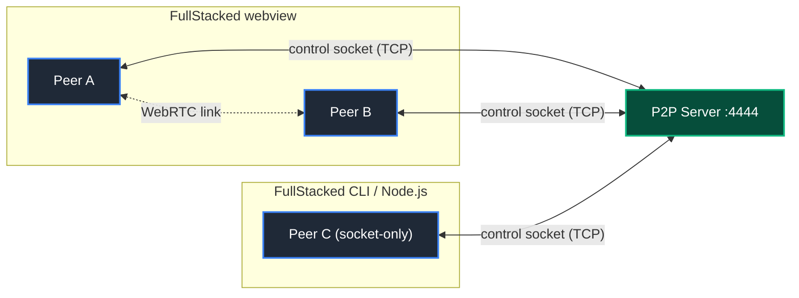

# FullStacked P2P

**FullStacked P2P** is a peer-to-peer signaling, presence, shared-state and relay server, with a TypeScript client driver for the **FullStacked runtime** and Node.js. Every peer connected to a Server is in its one room: peers see each other join and leave instantly, exchange direct messages, broadcasts and request/reply calls, share a persisted key-value state, and stream audio and video. Traffic goes peer-to-peer over WebRTC when it can, and through the server's TCP socket relay whenever it cannot.



---

## Principles

- **Works from the first millisecond**: every Client opens one `node:net` TCP control socket (`TCP_NODELAY`) and can message, broadcast and write state as soon as `connect()` resolves, before any WebRTC negotiation.
- **WebRTC when possible, TCP when not**: peers that both support WebRTC open a direct link (`p2p-reliable` and `p2p-ephemeral` DataChannels, plus media tracks). When UDP is blocked or NATs are symmetric, the pair keeps using the socket relay, transparently.
- **Socket-only is first class**: Node.js and the FullStacked CLI have no WebRTC API; their Clients use only the TCP socket and remain full peers (presence, messages, requests, state).
- **Smart fan-out**: senders list the peers they already reached over links in `deliveredTo`, and the Server relays only to the rest.
- **Conflict-free shared state**: per-key last-write-wins on Lamport versions `[clock, sessionId]`, identical on every replica, persisted atomically to `state.json` for late joiners.
- **One Server, one room**: everyone who connects is in the same room, with nothing to name or route. Separate rooms are separate Servers.
- **Multi-device by design**: one user can be in the same room from any number of devices at once; each device is its own peer with its own presence and links, and messages can target a user (all their devices) or one device.
- **Roles enforced by the Server**: `rw` peers, `ro` spectators, `admin`, and invisible inspector sessions for tools and data explorers at any role.
- **Zero dependencies**: Node.js 24 built-ins and web globals only. The Server is a plain TCP service on one port; Clients reach it with `node:net` (native in Node.js, provided by the FullStacked runtime).

---

## What This Repository Ships

| Artifact                              | What it is                                                                | Where                                                                     |
| :------------------------------------ | :------------------------------------------------------------------------ | :------------------------------------------------------------------------ |
| Docker image **`fullstackedorg/p2p`** | The Server (TypeScript on Node.js 24, no dependencies).                   | `Dockerfile`, `src/server/`                                               |
| npm package **`@fullstacked/p2p`**    | The client driver, for FullStacked apps, the FullStacked CLI and Node.js. | [`driver/`](driver/README.md) (sources in `src/client/`, `src/protocol/`) |

**Using the driver in an app?** Read [driver/README.md](driver/README.md): installation, connecting, presence, messaging, shared state, media, events, errors and recipes. It is the README published with the npm package, and every export carries TSDoc.

---

## Quickstart

Requires Node.js 24 LTS or newer.

### 1. Start the Server

```bash
node src/server/main.ts
```

No configuration: listens on `0.0.0.0:4444`, stores state in `./data/state.json`, and accepts every client with full permissions (open mode) to tinker, develop and test. Or with Docker:

```bash
docker build -t fullstackedorg/p2p .
docker run -d -p 4444:4444 fullstackedorg/p2p
```

For live environments, set passwords (strict mode) and any other [setting](docs/2-server/configuration.md): `-e P2P_RW_PASSWORD=... -e P2P_RO_PASSWORD=... -v p2p-data:/data`.

### 2. Connect Peers

```typescript
import { P2PClient } from "@fullstacked/p2p";

const p2p = await P2PClient.connect({
    host: "127.0.0.1",
    port: 4444, // open mode: no credentials needed; add user/password on a secured Server
    peer: { id: "usr_alice", name: "Alice", meta: { color: "#0080ff" } },
});

p2p.on("peer:joined", (peer) => console.log("joined", peer.name));
p2p.on("message", (event) => console.log(event.from.name, event.data, event.transport));
await p2p.setState("shape:1", { x: 10, y: 20, color: "#0080ff" });
```

The same code runs in FullStacked apps and the FullStacked CLI, which provide `node:net`; see [driver/README.md](driver/README.md#quick-start).

---

## Documentation

| Section         | Document                                             | Description                                                                               |
| :-------------- | :--------------------------------------------------- | :---------------------------------------------------------------------------------------- |
| **Concepts**    | [Glossary](docs/1-concepts/glossary.md)              | Definitions of every term used in these docs.                                             |
|                 | [Architecture](docs/1-concepts/architecture.md)      | Topology, runtime capabilities, transport selection, sequences, trust boundaries.         |
|                 | [Internals](docs/1-concepts/internals.md)            | Components, repository layout, entry points, module constraints.                          |
|                 | [Protocol Spec](docs/1-concepts/protocol-spec.md)    | Framing, handshake, every frame, error codes, close reasons, backpressure, limits.        |
| **Server**      | [Configuration](docs/2-server/configuration.md)      | Every `P2P_*` setting (all optional), open and strict mode.                               |
|                 | [Running the Server](docs/2-server/server.md)        | Local, Docker, health check, persistence, shutdown, exposure and TLS, embedding, sizing.  |
| **Subsystems**  | [Codec](docs/3-subsystems/codec.md)                  | Length-prefixed JSON frames, incremental decoder.                                         |
|                 | [Auth & Roles](docs/3-subsystems/auth.md)            | Credential verification, open mode, permission table.                                     |
|                 | [Room](docs/3-subsystems/room.md)                    | Registry, presence, relays, `deliveredTo`, backpressure, counters.                        |
|                 | [State Store](docs/3-subsystems/state-store.md)      | LWW versions, clocks, tombstones, size cap, snapshot format, Client replica.              |
|                 | [Inspection](docs/3-subsystems/inspection.md)        | Inspector sessions, `schema`, `query`.                                                    |
| **Client**      | [Driver README](driver/README.md)                    | Using `@fullstacked/p2p` in an app: the published guide.                                  |
|                 | [Client API](docs/4-client/client-api.md)            | `P2PClient` options, methods, events, errors.                                             |
|                 | [Transports](docs/4-client/transports.md)            | Control socket, links, socket-only environments, per-frame choice.                        |
|                 | [Media](docs/4-client/media.md)                      | Tracks on links, MediaRecorder → MSE fallback over the socket.                            |
| **Development** | [Standards & Style](docs/5-development/standards.md) | Prettier (4 spaces), 300 LOC, client portability, Node 24 type stripping.                 |
|                 | [Workflow & Tooling](docs/5-development/workflow.md) | Docs-as-Code → TDD → implementation, package scripts, quality gates.                      |
|                 | [Testing](docs/5-development/testing.md)             | Unit tests, integration tests with the FullStacked runtime submodule, Docker image tests. |
