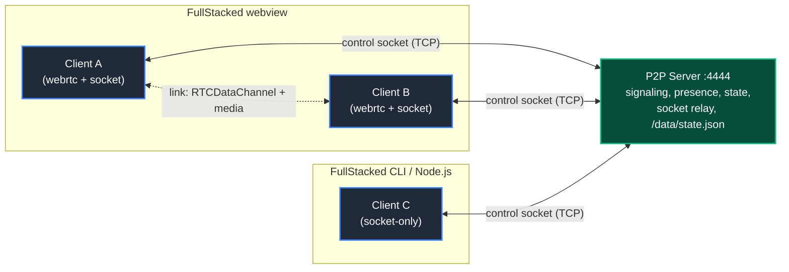
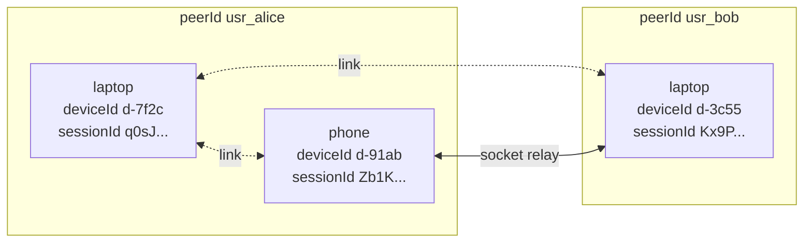
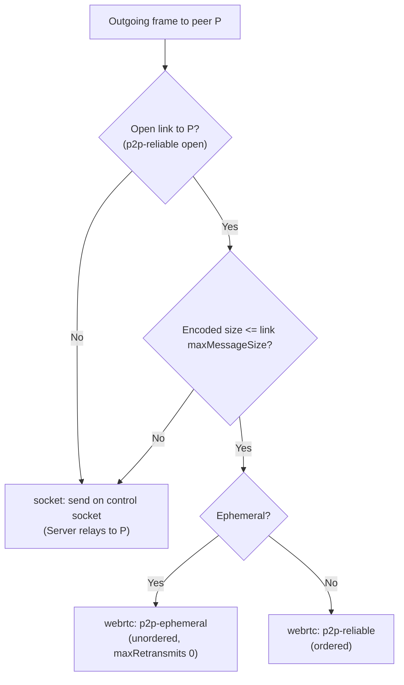
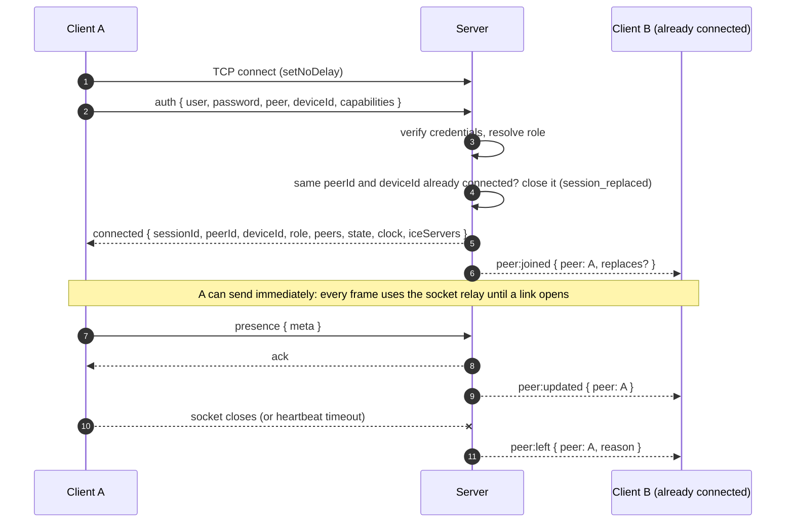
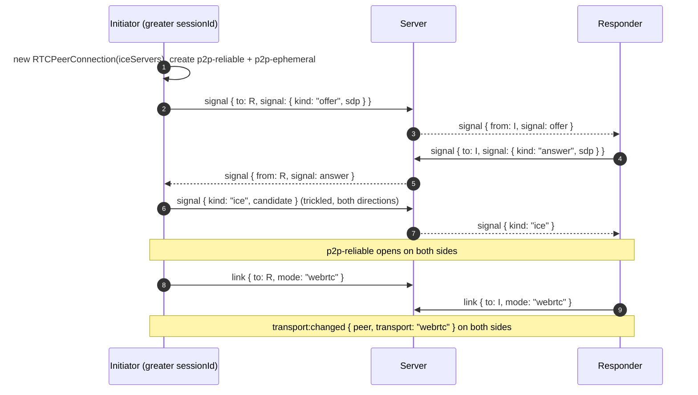
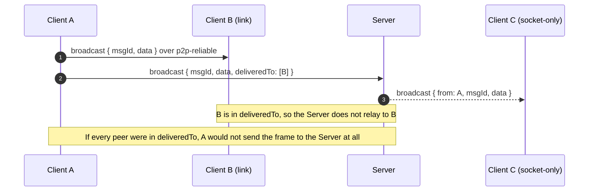
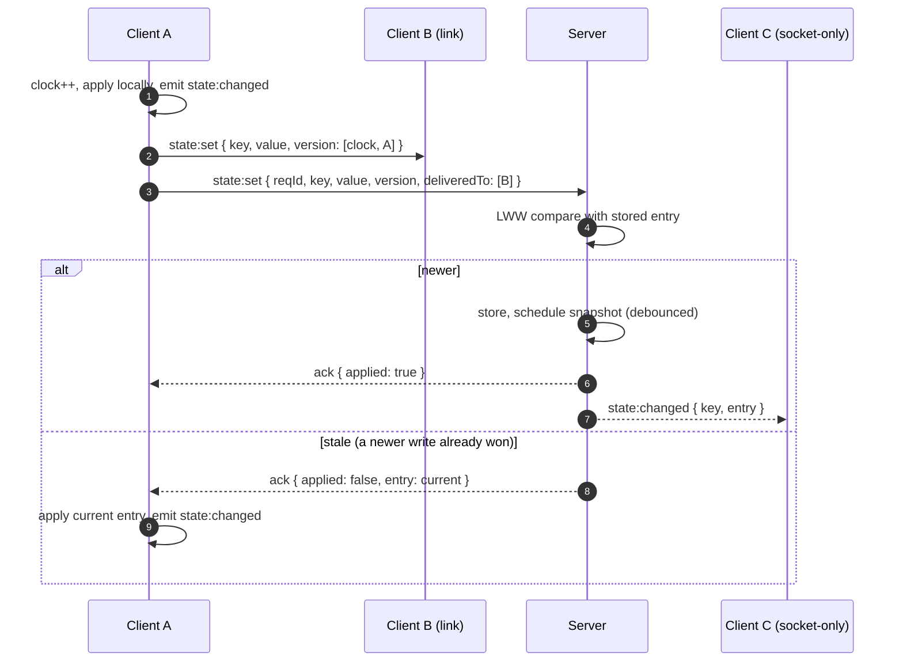
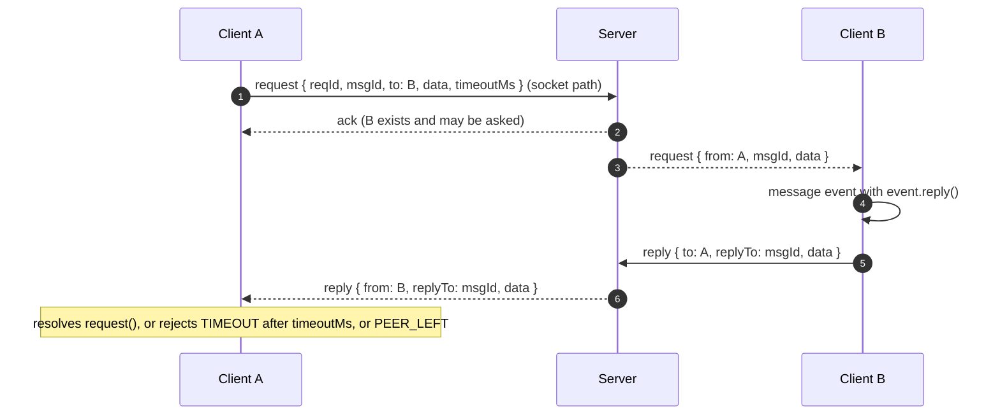

# Architecture

Terms are defined in the [Glossary](glossary.md). The exact frames are in the [Protocol Spec](protocol-spec.md).

---

## 1. Topology

- **One Server, one room.** Every peer that connects to a Server is in the same room: presence, messages and shared state are shared by all of them. There are no room names to choose and nothing to route between rooms. Separate rooms are separate Servers (one process or container each), which keeps each Server small, isolated and independently sized.
- **One control socket per Client.** Opened by `P2PClient.connect()` before anything else, kept for the whole session. It carries the handshake, presence, signaling, every state write, and the socket relay. Its `close` event is the presence signal: the Server announces `peer:left` the moment it fires (or when the heartbeat times out).
- **Links between peers that both support WebRTC.** Two Clients in FullStacked webviews negotiate a link through `signal` frames on their control sockets. Once a link's `p2p-reliable` DataChannel is open, frames to that peer go over the link; until then, and whenever it fails, they go through the socket relay.
- **The Server is a plain TCP service.** Clients connect to its host and port with `node:net`: natively in Node.js, through the runtime's `node:net` in FullStacked apps and the FullStacked CLI. Anything that carries a TCP connection to that port works, and the Server needs nothing else in front of it.

## 2. Identity: Users, Devices, Sessions

Collaborative apps routinely have one user signed in on several devices at once: a laptop and a phone, two browser windows, an app plus a script. The Server models three layers and never assumes one user is one connection.

| Layer   | Identifier  | Chosen by                                                              | Unique       | Lifetime                                                                                            |
| :------ | :---------- | :--------------------------------------------------------------------- | :----------- | :-------------------------------------------------------------------------------------------------- |
| User    | `peerId`    | The application (`peer.id`, typically its authenticated user id)       | No           | As long as the application keeps it.                                                                |
| Device  | `deviceId`  | The Client: random per `P2PClient` instance, or set by the application | Per `peerId` | The `P2PClient` instance, across its reconnects (longer if the application persists and passes it). |
| Session | `sessionId` | The Server                                                             | Yes          | One control socket.                                                                                 |

Rules:

- **Many devices per user.** Any number of sessions may share a `peerId`; there is no per-user limit (only `P2P_MAX_CONNECTIONS` bounds the Server as a whole). Each one is a full peer: its own presence `meta`, links, transport, media and cursor. `getActivePeers()` lists all of them, including the other devices of the local user.
- **Replacement only for the same device.** A new session with the same `peerId` **and** `deviceId` as an existing one replaces it (`session_replaced`): that is a Client reconnecting before the Server noticed its old socket died. The `peer:joined` for the new session carries `replaces: <old sessionId>` so applications can hand the old device's cursor and state over without flicker. Sessions with different `deviceId`s never affect each other.
- **Addressing.** A direct message to a `peerId` reaches every device of that user; a request to a `peerId` goes to one of them (the most recently connected). `{ sessionId }` targets exactly one device. See [Client API › Messaging](../4-client/client-api.md#3-messaging).
- **Own devices are ordinary peers.** A broadcast reaches the sender's other devices; `send(p2p.peerId, ...)` reaches only the sender's other devices; nothing is echoed to the sending session itself.
- **State attribution.** An entry's `updatedBy` is the writer's `peerId`; its `version[1]` is the `sessionId` of the device that wrote it.
- **Self-declared identity.** `peerId`, `deviceId`, `name` and `meta` are declared by the Client. Credentials prove a role, not a user, and every user of a deployment typically shares the same `rw` or `ro` credentials. Applications that must prove who a peer is exchange their own signed proof (for example a token from their identity provider in `meta`, verified by the receivers). See [Trust Boundaries](#6-trust-boundaries).

## 3. Runtime Capabilities

The Client detects its environment once, at `connect()`, and sends the result as `capabilities` in `auth`.

| Environment                                   | `node:net` control socket | Links (`RTCPeerConnection`) | Media (`shareMedia`, `peer:media`)            |
| :-------------------------------------------- | :------------------------ | :-------------------------- | :-------------------------------------------- |
| Node.js 24+                                   | Native                    | No: socket-only             | No                                            |
| FullStacked CLI (`platform/node`)             | Runtime shim              | No: socket-only             | No                                            |
| FullStacked webview (apps, headless Chromium) | Runtime shim              | Yes                         | Yes (tracks on links, MediaRecorder fallback) |
| Plain web browser (no FullStacked runtime)    | Unavailable               | n/a                         | n/a: not supported                            |

Detection rules:

- `webrtc` is `true` when `typeof globalThis.RTCPeerConnection === "function"` and the `webrtc` option is not `false`.
- `media` is `true` when `MediaStream`, `MediaRecorder` and `MediaSource` are all defined.

A socket-only Client is a full peer: it sees presence, sends and receives messages, reads and writes state, and answers requests. Only media is unavailable (`shareMedia` rejects with `UNSUPPORTED`, and the Server never sends it `media:chunk` frames).

## 4. Transport Selection

For every outgoing frame the Client picks a transport per target peer:

- `maxMessageSize` is `pc.sctp.maxMessageSize` when the browser exposes it, otherwise 65 536 bytes.
- Frames addressed to several peers (`broadcast`, `state:*`, and `send` to a `peerId` with several devices) go over every open link first, then once on the control socket with `deliveredTo` listing the sessions already reached. `state:*` frames always reach the Server, which persists them; a `broadcast` or `send` that reached every target over links is not sent to the Server at all.
- Media goes over links as tracks; `media:chunk` frames are only sent on the control socket, with `deliveredTo` listing the peers that receive the tracks. See [Media](../4-client/media.md).
- `getTransport(sessionId)` returns the transport currently used for that peer, and `transport:changed` fires when it changes.

## 5. Sequences

### 5.1 Join and Presence

### 5.2 Link Negotiation

Both peers have `capabilities.webrtc`, and at least one of them is `rw` or `admin` (two spectators have nothing to exchange). The initiator is the peer with the greater `sessionId`.

If the link does not open within 15 seconds, or the connection state becomes `failed`, the pair keeps using the socket relay. The initiator retries once after 30 seconds with a fresh negotiation (a new connection and generation), then gives up for the rest of the session. When an open link closes, both sides send `link { mode: "socket" }` and switch back to the socket relay. See [Transports](../4-client/transports.md).

### 5.3 Broadcast with `deliveredTo`

### 5.4 State Write

Every Client applies the same LWW rule to every entry it receives, whichever transport delivered it, so all replicas converge on the greatest version.

### 5.5 Request / Reply

Over a link, the `request` and `reply` frames travel on `p2p-reliable` and the Server is not involved.

## 6. Trust Boundaries

- **The Server is the authority** for sessions (`sessionId`), roles, presence and the persisted state. It stamps `from` on every relayed frame and never trusts a `from` sent by a Client.
- **User identity is declared, not proven.** The Server keeps `peerId` and `deviceId` consistent (one `peerId` per session, replacement only for the same device) but does not verify them: anyone holding `rw` credentials can claim any `peerId`. See [Identity](#2-identity-users-devices-sessions).
- **Roles are enforced by the Server** on the control socket. On links, honest Clients enforce them too: a Client drops every publishing frame (`send`, `broadcast`, `request`, `state:*`, `media:chunk`) that arrives over a link from a peer whose `PeerInfo.role` is `ro`. A modified spectator Client can therefore only reach peers that run a modified Client as well.
- **Links are end-to-end encrypted** (DTLS/SRTP). The control socket is plain TCP: keep the Server on a trusted network, or put a TLS-terminating TCP proxy (or an encrypted transport of your choice) in front of it when it crosses an untrusted one. See [Server](../2-server/server.md#6-exposure-and-tls).
- **`deliveredTo` only narrows the relay.** A Client that lies in it can only prevent its own frames from reaching some peers.
