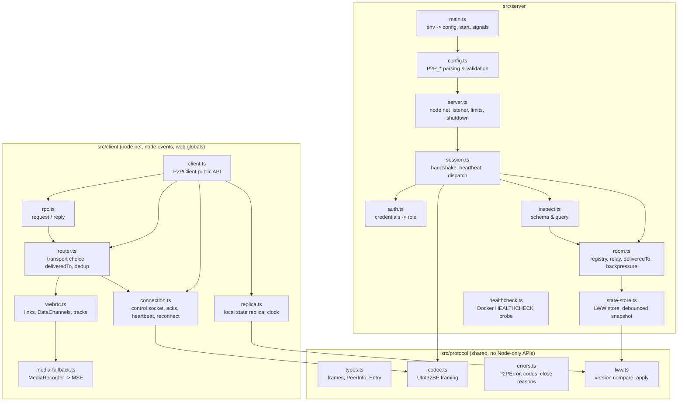

# Internals & Repository Layout



Terms are defined in the [Glossary](glossary.md).

---

## 1. Components

| Component   | File(s)                 | Responsibility                                                                                                     | Doc                                           |
| :---------- | :---------------------- | :----------------------------------------------------------------------------------------------------------------- | :-------------------------------------------- |
| Codec       | `protocol/codec.ts`     | Encode frames, incremental decoder over a byte stream, size checks.                                                | [Codec](../3-subsystems/codec.md)             |
| LWW         | `protocol/lww.ts`       | `compareVersion`, `applyEntry`; the single implementation used by the Server store and the Client replica.         | [State Store](../3-subsystems/state-store.md) |
| Config      | `server/config.ts`      | Reads and validates every `P2P_*` variable; fails fast on invalid values.                                          | [Configuration](../2-server/configuration.md) |
| Listener    | `server/server.ts`      | `node:net` server, `setNoDelay(true)` on accept, connection cap, graceful shutdown, final snapshot flush.          | [Server](../2-server/server.md)               |
| Session     | `server/session.ts`     | Per-socket state machine: pre-auth, authenticated, closing. Heartbeat. Frame dispatch and role checks.             | [Protocol Spec](protocol-spec.md)             |
| Auth        | `server/auth.ts`        | Constant-time credential check, role resolution, open mode.                                                        | [Auth & Roles](../3-subsystems/auth.md)       |
| Room        | `server/room.ts`        | The room: peer registry, `peerId` replacement, relays with `deliveredTo`, backpressure, media resync, link report. | [Room](../3-subsystems/room.md)               |
| State Store | `server/state-store.ts` | Entries and clock, size accounting, tombstone purge, atomic debounced snapshot.                                    | [State Store](../3-subsystems/state-store.md) |
| Inspection  | `server/inspect.ts`     | `schema` and `query` operations.                                                                                   | [Inspection](../3-subsystems/inspection.md)   |
| P2PClient   | `client/*.ts`           | Public API, control socket, links, routing, replica, RPC, media.                                                   | [Client API](../4-client/client-api.md)       |

## 2. Repository Layout

```
fullstackedorg/p2p/
├── package.json                 # @fullstacked/p2p (the driver package) + scripts and dev tools
├── .npmignore                   # what the package ships: package.json, README.md, src/client, src/protocol
├── README.md                    # the driver guide (ships with the package)
├── tsconfig.json
├── Dockerfile                   # node:24-alpine, EXPOSE 4444, VOLUME /data, HEALTHCHECK
├── docker-compose.test.yml      # the image under test, for test/integration/docker.test.ts
├── docs/                        # this documentation (Docs-as-Code), index in docs/README.md
├── integration/
│   └── fullstacked/             # submodule fullstackedorg/fullstacked (branch v1): the runtime
├── scripts/
│   ├── check-loc.ts             # 300 LOC budget for src/
│   └── test-integration.ts      # compose up, node --test test/integration, compose down
├── src/
│   ├── protocol/{types,codec,errors,lww}.ts
│   ├── client/{index,client,connection,context,messaging,state,replica,peers,rpc,router,wiring,webrtc,media-fallback}.ts
│   └── server/{main,config,log,server,session,handlers,auth,room,state-store,inspect,healthcheck}.ts
└── test/
    ├── helpers.ts               # startServer, connectClient, waitForEvent, temp dirs
    ├── fake-rtc.ts              # in-memory RTCPeerConnection pair for unit tests
    ├── *.test.ts                # unit tests (see Testing)
    └── integration/
        ├── helpers/{runtime,p2p,page-app,env}.ts
        └── *.test.ts            # FullStacked CLI, webview, mixed, media, package, docker
```

The test layout is described in [Testing](../5-development/testing.md).

## 3. Distribution

| Artifact                          | Contents                                                                                                                                                                                                                                                                                                                                                                                                                                                                                                                                                                                                                                                                                                                                                                                            |
| :-------------------------------- | :-------------------------------------------------------------------------------------------------------------------------------------------------------------------------------------------------------------------------------------------------------------------------------------------------------------------------------------------------------------------------------------------------------------------------------------------------------------------------------------------------------------------------------------------------------------------------------------------------------------------------------------------------------------------------------------------------------------------------------------------------------------------------------------------------- |
| npm package `@fullstacked/p2p`    | The client driver only, from the repository root: the root `package.json` and the root `README.md` (the usage guide). Its `exports` resolve `types` and `default` to `./src/client/index.ts` (FullStacked bundles the TypeScript) and `node` to `./dist/index.js`, a single ESM file esbuild builds from the same sources (`scripts/build-driver.ts`, run by `prepare`), because Node.js does not strip types under `node_modules`. `.npmignore` keeps `package.json`, `README.md`, `src/client`, `src/protocol` and `dist`, for `npm publish` and for installs straight from GitHub (`github:fullstackedorg/p2p`), which npm and the FullStacked installer both trim with it. `import { P2PClient, P2PError } from "@fullstacked/p2p"`. It imports only `node:net`, `node:events` and web globals. |
| Docker image `fullstackedorg/p2p` | The Server: `src/` and `package.json` on `node:24-alpine`, started with `node src/server/main.ts`. See [Server](../2-server/server.md#2-docker).                                                                                                                                                                                                                                                                                                                                                                                                                                                                                                                                                                                                                                                    |

A GitHub install through the FullStacked installer runs no script, so it has no `dist/`: FullStacked resolves the `default` condition (the TypeScript sources) and never needs it. A GitHub install through npm runs `prepare`, which builds `dist/`.

## 4. Module Constraints

- `src/protocol/` and `src/client/` use only `node:net`, `node:events` and web-standard globals (`TextEncoder`, `TextDecoder`, `crypto.getRandomValues`, `RTCPeerConnection`, `MediaRecorder`, `MediaSource`). No `Buffer`, no `node:crypto`, no `node:fs`: the same files must run under Node.js, the FullStacked CLI and the FullStacked webview.
- `src/server/` may use any Node.js built-in (`node:net`, `node:crypto`, `node:fs/promises`, `node:path`, `node:events`).
- Dependencies flow one way: `server` → `protocol`, `client` → `protocol`. `server` and `client` never import each other.

## 5. Runtime Profiles

| Profile           | How it runs                                                  | Notes                                                                                  |
| :---------------- | :----------------------------------------------------------- | :------------------------------------------------------------------------------------- |
| Local development | `node src/server/main.ts`                                    | State in `./data`, open mode when no password is set.                                  |
| Docker            | `docker run -p 4444:4444 -v p2p-data:/data ...`              | `P2P_DATA_DIR=/data`, runs as `node`, `HEALTHCHECK` every 10 s.                        |
| Embedded (tests)  | `new P2PServer(config).listen()` from `src/server/server.ts` | The unit and integration tests (port `0`, temp data dir). Not part of the npm package. |
