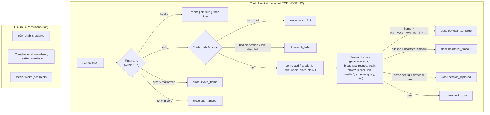

# Wire Protocol Specification



This document is the normative reference for everything that crosses a network boundary: framing, the handshake, every frame type, error codes, close reasons, limits and timeouts. Terms are defined in the [Glossary](glossary.md).

---

## 1. Framing

Every frame on a control socket is:

```
+----------------------+-------------------------------+
| length: UInt32BE (4) | payload: UTF-8 JSON (length)  |
+----------------------+-------------------------------+
```

- `length` counts payload bytes only. `0` is invalid.
- The payload is one JSON object with a string `type`.
- A frame whose `length` exceeds `P2P_MAX_PAYLOAD_BYTES` (default 1 MiB) is fatal: the Server sends `close { reason: "payload_too_large" }` and ends the socket without reading the payload. The Client checks the encoded size before sending and rejects the call with `PAYLOAD_TOO_LARGE` instead.
- A payload that is not valid JSON, has no string `type`, or has an unknown `type` closes the socket with `invalid_frame`.
- On links, each frame is one DataChannel string message containing the same JSON object, without the length prefix.

The codec is described in [Codec](../3-subsystems/codec.md).

## 2. Handshake

### 2.1 `auth` (Client → Server)

The first frame on a socket, sent within 10 seconds of connecting:

```json
{
    "type": "auth",
    "reqId": 1,
    "version": 1,
    "user": "rw",
    "password": "secret",
    "mode": "peer",
    "peer": {
        "id": "usr_alice",
        "name": "Alice",
        "meta": { "color": "#0080ff", "device": "laptop" }
    },
    "deviceId": "d-7f2c41e9b0",
    "capabilities": { "webrtc": true, "media": true }
}
```

| Field          | Required | Description                                                                                                                                                                                                |
| :------------- | :------- | :--------------------------------------------------------------------------------------------------------------------------------------------------------------------------------------------------------- |
| `version`      | yes      | Protocol version. This document is version `1`. Another value closes with `unsupported_version`.                                                                                                           |
| `user`         | no       | Username, matched against the configured users; `""` when omitted. Optional in open mode. See [Auth & Roles](../3-subsystems/auth.md).                                                                     |
| `password`     | no       | Password; `""` when omitted. Ignored in open mode.                                                                                                                                                         |
| `mode`         | no       | `"peer"` (default) or `"inspect"` (inspector session, any role). Inspectors ignore `peer.meta`, `deviceId` and `capabilities`; `peer.id` and `peer.name` only attribute their `query` writes and messages. |
| `peer.id`      | no       | `peerId`, 1–128 characters. Shared by every device of the same user. Defaults to the `sessionId`.                                                                                                          |
| `deviceId`     | no       | 1–128 characters, identifies the Client instance. Defaults to the `sessionId` (the session can then never be replaced). `P2PClient` always sends one.                                                      |
| `peer.name`    | no       | Display name, up to 128 characters. Defaults to `peerId`.                                                                                                                                                  |
| `peer.meta`    | no       | Any JSON object. Defaults to `{}`.                                                                                                                                                                         |
| `capabilities` | no       | `{ webrtc, media }`, both default `false`.                                                                                                                                                                 |

A Client that sends `auth` twice, or any session frame before `auth`, is closed with `invalid_frame`.

### 2.2 `health` (Client → Server, pre-auth only)

`{ "type": "health" }` instead of `auth` gets `{ "type": "health", "ok": true }` and the socket is closed with `client_close`. Used by the [Docker health check](../2-server/server.md#health-check).

### 2.3 `connected` (Server → Client)

```json
{
    "type": "connected",
    "reqId": 1,
    "sessionId": "q0sJ3m9xZ2V4yB7nT1uKpA",
    "peerId": "usr_alice",
    "deviceId": "d-7f2c41e9b0",
    "role": "rw",
    "peers": [
        {
            "peerId": "usr_bob",
            "sessionId": "...",
            "deviceId": "d-3c55a0f2e1",
            "name": "Bob",
            "meta": {},
            "role": "rw",
            "capabilities": { "webrtc": true, "media": true },
            "connectedAt": 1792000000000
        }
    ],
    "state": {
        "shape:1": {
            "value": { "x": 10 },
            "deleted": false,
            "version": [41, "..."],
            "updatedBy": "usr_bob",
            "updatedAt": 1792000000000
        }
    },
    "clock": 41,
    "iceServers": [],
    "limits": { "maxPayloadBytes": 1048576 },
    "heartbeat": { "intervalMs": 10000, "timeoutMs": 30000 }
}
```

- `peers` lists every other visible peer, including the other devices of the same `peerId` (never the session itself, never inspector sessions).
- Inspector sessions get `peers: []` and `state: {}`; they read through `query`.
- `state` holds every entry, tombstones included.
- `clock` is the Server's clock; the Client raises its own clock to it.
- `iceServers` comes from `P2P_ICE_SERVERS`. A Client-side `webrtc.iceServers` option overrides it.

Identity rules, applied before `connected` is sent (see [Identity](architecture.md#2-identity-users-devices-sessions)):

1. **Replacement.** A visible session with the same `peerId` **and** `deviceId` is closed with `session_replaced` and announced with `peer:left` **before** the new session is announced with `peer:joined { peer, replaces: <old sessionId> }`.
2. Sessions of the same `peerId` with different `deviceId`s coexist, in any number, and never affect each other.

## 3. Requests, Acknowledgements and Errors

Frames that carry a `reqId` get exactly one answer: `ack` or `error`.

```json
{ "type": "ack", "reqId": 7 }
{ "type": "ack", "reqId": 8, "applied": false, "entry": { "...": "..." } }
{ "type": "error", "reqId": 9, "code": "READ_ONLY", "message": "Read-only client cannot publish or mutate state" }
```

Errors with a `reqId` are not fatal: the session continues. The Client rejects the matching Promise with `P2PError` (`err.code`, `err.message`). A rejected frame that had no `reqId` (`signal`, `reply`, an ephemeral frame) gets an `error` frame without one; the Client emits it as an `error` event.

### 3.1 Error Codes

| Code                                                       | Raised by      | Meaning                                                                                                                      |
| :--------------------------------------------------------- | :------------- | :--------------------------------------------------------------------------------------------------------------------------- |
| `READ_ONLY`                                                | Server, Client | The session's role is `ro` and the operation publishes or mutates.                                                           |
| `TARGET_READ_ONLY`                                         | Server, Client | `request` targets a spectator, which cannot reply.                                                                           |
| `FORBIDDEN`                                                | Server         | A peer frame (`presence`, `send`, `broadcast`, `request`, `state:*`, `signal`, `link`, `media:*`) from an inspector session. |
| `PEER_NOT_FOUND`                                           | Server, Client | The target has no visible peer: an unknown `sessionId`, or a `peerId` with no session other than the sender's.               |
| `PAYLOAD_TOO_LARGE`                                        | Client         | The encoded frame exceeds `limits.maxPayloadBytes`. (On the Server this is a close reason.)                                  |
| `STATE_TOO_LARGE`                                          | Server         | Applying the write would make the snapshot exceed `P2P_MAX_STATE_BYTES`.                                                     |
| `INVALID_ARGUMENT`                                         | Server, Client | A field has the wrong type or is out of range (e.g. empty key, key over 256 characters, unknown `operation`).                |
| `TIMEOUT`                                                  | Client         | No answer within the deadline (`request` reply, `ack`, connect).                                                             |
| `PEER_LEFT`                                                | Client         | The target of a pending `request` left before replying.                                                                      |
| `DISCONNECTED`                                             | Client         | The control socket is down; the call was not sent or its answer can no longer arrive.                                        |
| `UNSUPPORTED`                                              | Client         | The environment lacks the API (`shareMedia` without media capability).                                                       |
| `REPLY_ERROR`                                              | Client         | The replying peer threw or called `reply` with an error; `err.message` carries its message.                                  |
| `AUTH_FAILED`, `SERVER_FULL`, `SESSION_REPLACED`, `CLOSED` | Client         | `connect()` or the session ended with the matching close reason (see §6).                                                    |

## 4. Presence

### 4.1 `PeerInfo`

```typescript
type PeerInfo = {
    peerId: string; // the user: shared by all their devices
    sessionId: string; // this connection: unique
    deviceId: string; // this device: unique per peerId
    name: string;
    meta: Record<string, unknown>;
    role: "admin" | "rw" | "ro";
    capabilities: { webrtc: boolean; media: boolean };
    connectedAt: number; // epoch ms
};
```

### 4.2 Frames

| Frame                             | Direction | Description                                                                                                                           |
| :-------------------------------- | :-------- | :------------------------------------------------------------------------------------------------------------------------------------ |
| `presence { reqId, meta, name? }` | C → S     | Replaces this session's `meta` (and `name`); other devices of the same `peerId` keep theirs. `rw` and `admin` only, else `READ_ONLY`. |
| `peer:joined { peer, replaces? }` | S → C     | A visible session joined the room. `replaces` is the `sessionId` of the same device's previous session.                               |
| `peer:updated { peer }`           | S → C     | A peer's `meta` / `name` changed.                                                                                                     |
| `peer:left { peer, reason }`      | S → C     | A peer's session ended. `reason` is its close reason (§6).                                                                            |

## 5. Session Frames

The Server adds `from` (the sender's `sessionId`) to every frame it relays and drops any `from` a Client sends. Frames sent by an inspector session (through `query`) also carry `sender: { peerId, role }`, since inspectors are not listed peers. `msgId` must start with the sender's own `sessionId` followed by `:`, else `INVALID_ARGUMENT`.

### 5.1 Messaging

| Frame                                                        | Direction | Notes                                                                                                                                                                          |
| :----------------------------------------------------------- | :-------- | :----------------------------------------------------------------------------------------------------------------------------------------------------------------------------- |
| `send { reqId?, msgId, to, data, ephemeral?, deliveredTo? }` | C → S → C | `to` is `{ peerId }` (every session of that user except the sender and `deliveredTo`) or `{ sessionId }` (one session). `reqId` is omitted for ephemeral frames (no `ack`).    |
| `broadcast { reqId?, msgId, data, ephemeral?, deliveredTo }` | C → S → C | Relayed to every peer except the sender and `deliveredTo`, including the sender's other devices.                                                                               |
| `request { reqId, msgId, to, data, timeoutMs }`              | C → S → C | `to` is `{ sessionId }`: the Client picks one device when the caller targets a `peerId`. `ack` means routed. `TARGET_READ_ONLY` if the target is `ro`.                         |
| `reply { msgId, to, replyTo, data?, error? }`                | C → S → C | `to` is the requester's `sessionId`; `replyTo` is the request's `msgId`. `error` is `{ message }`. Allowed for every role, but only to a session that sent this one a request. |

Ephemeral `send` and `broadcast` frames are subject to [drop-on-backpressure](#7-backpressure).

### 5.2 Shared State

| Frame                                                   | Direction | Notes                                                                              |
| :------------------------------------------------------ | :-------- | :--------------------------------------------------------------------------------- |
| `state:set { reqId, key, value, version, deliveredTo }` | C → S     | `ack { applied, entry? }`. `entry` is the winning entry when `applied` is `false`. |
| `state:delete { reqId, key, version, deliveredTo }`     | C → S     | Stores a tombstone. Same `ack` as `state:set`.                                     |
| `state:clear { reqId, version, deliveredTo }`           | C → S     | Tombstones every live entry whose version is lower than `version`.                 |
| `state:changed { from, key, entry }`                    | S → C     | Relayed `state:set` / `state:delete` that won, to members not in `deliveredTo`.    |
| `state:cleared { from, version, updatedBy }`            | S → C     | Relayed `state:clear`.                                                             |

Over links the sender uses the same `state:set`, `state:delete`, `state:clear` frames without `reqId` and `deliveredTo`. `key` is a non-empty string of at most 256 characters. `version` must be `[clock, <sender sessionId>]`. The Server raises its clock to `clock`.

### 5.3 Link Signaling

| Frame                   | Direction | Notes                                                                                                                                                                                       |
| :---------------------- | :-------- | :------------------------------------------------------------------------------------------------------------------------------------------------------------------------------------------ |
| `signal { to, signal }` | C → S → C | `signal` is `{ kind: "offer" \| "answer", sdp }` or `{ kind: "ice", candidate }`. Rejected with `INVALID_ARGUMENT` when either side lacks `webrtc` or both are `ro`. `to` is a `sessionId`. |
| `link { to, mode }`     | C → S     | `mode` is `"webrtc"` or `"socket"`. Informational: reported by `schema`, never used for routing.                                                                                            |

### 5.4 Media Fallback

| Frame                                                               | Direction | Notes                                                                                                                                                  |
| :------------------------------------------------------------------ | :-------- | :----------------------------------------------------------------------------------------------------------------------------------------------------- |
| `media:chunk { streamId, gen, seq, mime, init, data, deliveredTo }` | C → S → C | `data` is base64 of one `MediaRecorder` blob. `init: true` marks the first chunk of a recorder generation. Relayed only to `capabilities.media` peers. |
| `media:resync { streamId, from }`                                   | S → C     | Sent to the stream's sender when the Server dropped a chunk for a receiver; the sender restarts its recorder (new `gen`).                              |
| `media:end { streamId }`                                            | C → S → C | The sender stopped sharing.                                                                                                                            |

`rw` and `admin` only. See [Media](../4-client/media.md).

### 5.5 Inspection

| Frame                             | Direction | Notes                                                                   |
| :-------------------------------- | :-------- | :---------------------------------------------------------------------- |
| `schema { reqId }`                | C → S     | All roles. `ack` carries the schema.                                    |
| `query { reqId, operation, ... }` | C → S     | All roles for reads, `rw` / `admin` for writes. `ack` carries `result`. |

See [Inspection](../3-subsystems/inspection.md).

### 5.6 Keep-Alive and Closing

| Frame                        | Direction | Notes                                                                                               |
| :--------------------------- | :-------- | :-------------------------------------------------------------------------------------------------- |
| `ping`                       | C → S     | Sent by the Client when it has sent nothing for `heartbeat.intervalMs`.                             |
| `pong`                       | S → C     | Answer to `ping`.                                                                                   |
| `bye`                        | C → S     | Clean close (`p2p.close()`): the Server removes the session immediately with reason `client_close`. |
| `close { reason, message? }` | S → C     | Sent before the Server ends a socket. Always the last frame.                                        |

## 6. Close Reasons

Every socket the Server ends gets a `close` frame with one of these reasons, and `peer:left` carries the same reason. A socket that drops without a `close` frame (network loss) is reported as `connection_lost`.

| Reason                | Client error code  | Reconnects?               | Cause                                                                    |
| :-------------------- | :----------------- | :------------------------ | :----------------------------------------------------------------------- |
| `client_close`        | `CLOSED`           | No                        | `bye` received, or after `health`.                                       |
| `connection_lost`     | `DISCONNECTED`     | Yes                       | The socket closed without a `close` frame.                               |
| `heartbeat_timeout`   | `DISCONNECTED`     | Yes                       | Nothing received for `P2P_HEARTBEAT_TIMEOUT`.                            |
| `auth_timeout`        | `TIMEOUT`          | Yes                       | No `auth` within 10 s.                                                   |
| `auth_failed`         | `AUTH_FAILED`      | Only with `beforeConnect` | Unknown user, wrong password, or disabled role.                          |
| `unsupported_version` | `CLOSED`           | No                        | `auth.version` is not `1`.                                               |
| `server_full`         | `SERVER_FULL`      | Yes                       | `P2P_MAX_CONNECTIONS` authenticated sessions already open.               |
| `payload_too_large`   | `CLOSED`           | Yes                       | Frame length over `P2P_MAX_PAYLOAD_BYTES`.                               |
| `slow_consumer`       | `DISCONNECTED`     | Yes                       | Over `P2P_MAX_BUFFERED_BYTES` of reliable frames queued for this socket. |
| `invalid_frame`       | `CLOSED`           | No                        | Malformed frame, unknown `type`, or session frame before `auth`.         |
| `session_replaced`    | `SESSION_REPLACED` | No                        | A new session authenticated with the same `peerId` and `deviceId`.       |
| `server_shutdown`     | `DISCONNECTED`     | Yes                       | `SIGINT` / `SIGTERM`.                                                    |

"Reconnects?" is the Client's behavior when `reconnect` is enabled. Arbitrary error text is logged, never sent as a reason.

## 7. Backpressure

For each relayed ephemeral frame (ephemeral `send` / `broadcast`, and `media:chunk` with `init: false`), the Server checks the recipient's `socket.writableLength`:

- At or below 65 536 bytes: written.
- Above: dropped for that recipient. For `media:chunk`, the recipient is marked out of sync for that `streamId`: every later chunk is dropped for it until a chunk with `init: true`, and the sender gets one `media:resync`.

Reliable frames are never dropped; they queue in the socket buffer. A recipient whose `writableLength` exceeds `P2P_MAX_BUFFERED_BYTES` (default 8 MiB) cannot keep up and is closed with `slow_consumer`; its Client reconnects and receives the full state again. See [Room](../3-subsystems/room.md#slow-consumers).

## 8. Deduplication and Ordering

- Every Client keeps, per sender `sessionId`, the last 1 024 `msgId`s it delivered and drops repeats. A frame can arrive twice when a link opens or closes while it is in flight.
- State frames need no `msgId`: re-applying an entry with the same version is a no-op.
- Reliable frames are ordered per transport. When a pair switches transport, a frame sent over the new transport can overtake one still in the old; applications that need strict ordering across a switch must sequence their own payloads. Shared state is unaffected (LWW).
- Reliable frames sent on a link that fails before delivery are not retransmitted on the socket (at-most-once). `request` reports this as `TIMEOUT`; shared state is unaffected because every write also reaches the Server.

## 9. Timeouts and Limits

| Name                   | Value                                 | Where                                                            |
| :--------------------- | :------------------------------------ | :--------------------------------------------------------------- |
| Auth deadline          | 10 s                                  | Server: first frame after TCP connect.                           |
| Connect timeout        | `connectTimeoutMs` (10 s)             | Client: TCP connect + `connected`.                               |
| Ack timeout            | 10 s                                  | Client: any frame with `reqId`.                                  |
| Request timeout        | `timeoutMs` (default 10 s, max 120 s) | Client: `request()` reply.                                       |
| Heartbeat interval     | `P2P_HEARTBEAT_INTERVAL` (10 s)       | Client sends `ping` when idle for this long.                     |
| Heartbeat timeout      | `P2P_HEARTBEAT_TIMEOUT` (30 s)        | Server closes; Client treats the socket as lost.                 |
| Link open deadline     | 15 s                                  | Client: offer to `p2p-reliable` open.                            |
| Link retry             | once, after 30 s, fresh negotiation   | Initiator only.                                                  |
| Max frame              | `P2P_MAX_PAYLOAD_BYTES` (1 MiB)       | Both sides.                                                      |
| Max state              | `P2P_MAX_STATE_BYTES` (64 MiB)        | Server: snapshot size.                                           |
| Key length             | 256 characters                        | Both sides.                                                      |
| Snapshot debounce      | 100 ms, at most 1 s delay             | Server.                                                          |
| Tombstone retention    | 24 h                                  | Server: purged at snapshot time; Clients drop them on reconnect. |
| Dedup window           | 1 024 `msgId`s per sender             | Client.                                                          |
| Backpressure threshold | 65 536 bytes                          | Server, per recipient socket.                                    |
| Reliable buffer        | `P2P_MAX_BUFFERED_BYTES` (8 MiB)      | Server, per recipient socket, then `slow_consumer`.              |
