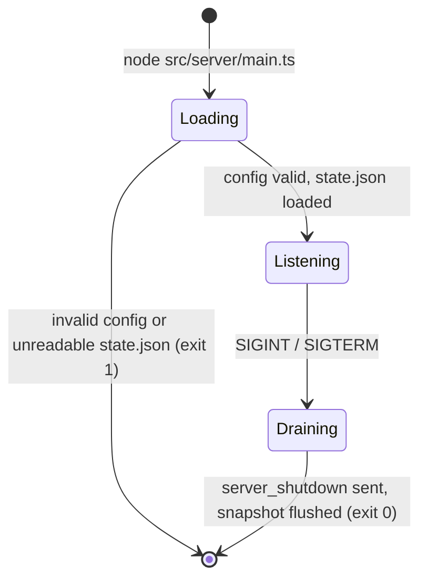

# Running the Server



Settings are listed in [Configuration](configuration.md). Terms are defined in the [Glossary](../1-concepts/glossary.md).

---

## 1. Local

```bash
node src/server/main.ts
```

Listens on `0.0.0.0:4444`, stores state in `./data/state.json`, and runs in open mode (any password for users `rw` and `ro`) until a password is configured.

## 2. Docker

```dockerfile
FROM node:24-alpine

WORKDIR /app
ENV NODE_ENV=production P2P_DATA_DIR=/data

COPY package.json ./
COPY src ./src

RUN mkdir -p /data && chown node:node /data
USER node
VOLUME /data
EXPOSE 4444

HEALTHCHECK --interval=10s --timeout=3s --start-period=5s --retries=3 \
    CMD ["node", "src/server/healthcheck.ts"]

CMD ["node", "src/server/main.ts"]
```

There is no `npm ci` step: the Server has no runtime dependencies.

```bash
docker build -t fullstackedorg/p2p .
docker run -d --name p2p -p 4444:4444 -v p2p-data:/data \
  -e P2P_RW_PASSWORD=change-me -e P2P_RO_PASSWORD=spectate -e P2P_ADMIN_PASSWORD=admin-secret \
  fullstackedorg/p2p
```

### Health Check

`src/server/healthcheck.ts` connects to `127.0.0.1:$P2P_PORT`, sends a `health` frame and exits `0` when `{ "type": "health", "ok": true }` arrives within 3 seconds, `1` otherwise. It proves the listener accepts and the event loop answers; it needs no credentials and creates no session.

## 3. Startup

1. Parse and validate configuration. Invalid → exit `1`.
2. Create `P2P_DATA_DIR` if missing. Remove a leftover `state.json.tmp` (an interrupted write; the previous `state.json` is intact).
3. Load `state.json`. Missing → empty state. Unreadable or invalid JSON → log the error and exit `1`; the Server never silently starts empty over existing data. Move the file aside to start fresh.
4. Listen. Log the address, the enabled roles, and the open-mode warning when it applies.

## 4. Persistence

- Every accepted `state:set`, `state:delete` and `state:clear` marks the store dirty and schedules a snapshot 100 ms later; a continuous stream of writes still produces a snapshot at least once per second.
- A snapshot writes the whole file to `state.json.tmp`, `fsync`s it, and `rename`s it over `state.json`. A crash leaves either the old or the new snapshot, never a partial one.
- `ack` is sent when the write is accepted in memory, before the snapshot. A crash can lose up to one second of acknowledged writes.
- The snapshot format is described in [State Store](../3-subsystems/state-store.md#6-snapshot-format).

## 5. Shutdown

On `SIGINT` or `SIGTERM`:

1. Stop accepting connections.
2. Send `close { reason: "server_shutdown" }` to every session and end the sockets. Clients with `reconnect` enabled retry with backoff, so a restarted or replaced Server picks them up.
3. Flush a final snapshot if the store is dirty.
4. Exit `0`. A second signal exits immediately with code `1`.

`P2PServer.close()` runs steps 1–3 for embedded (test) servers.

## 6. Exposure and TLS

The control socket is plain TCP. Links are always encrypted (DTLS), but presence, signaling, state and relayed messages travel on the control socket.

- Keep the port on a trusted network (a private network, a VPN, a container network), or
- put a TLS-terminating TCP proxy, or any transport that carries a TCP connection, in front of it.

`P2PClient` speaks plain TCP and has no TLS option of its own. The Server does not use client IP addresses for anything, so proxies in front of it need no special configuration.

## 7. Embedding (tests)

The Server is distributed only as the Docker image; the npm package contains the client driver. Inside the repository, the tests embed it directly:

```typescript
import { loadConfig } from "../src/server/config.ts";
import { P2PServer } from "../src/server/server.ts";

const server = new P2PServer({ ...loadConfig(process.env), port: 0, dataDir: tmpDir });
const { port } = await server.listen();
// ...
await server.close();
```

| Member                  | Description                                                                                                                                                                                                                                                                      |
| :---------------------- | :------------------------------------------------------------------------------------------------------------------------------------------------------------------------------------------------------------------------------------------------------------------------------- |
| `new P2PServer(config)` | `config` is what `loadConfig` returns: the `P2P_*` variables in camelCase (`maxPayloadBytes`, `rwPassword`, ...), durations in milliseconds (`heartbeatIntervalMs`, `heartbeatTimeoutMs`), plus test hooks (`authTimeoutMs`, `snapshotDebounceMs`, `snapshotMaxDelayMs`, `now`). |
| `listen()`              | Loads the snapshot and listens. Resolves `{ host, port }`.                                                                                                                                                                                                                       |
| `close()`               | Shutdown steps 1–3. Resolves when the snapshot is flushed.                                                                                                                                                                                                                       |
| `flush()`               | Writes a snapshot now if dirty.                                                                                                                                                                                                                                                  |
| `on("session", info)`   | Emitted on every session open and close with `{ event, peerId, deviceId, sessionId, role, mode, reason? }` (logging, metrics).                                                                                                                                                   |

## 8. Sizing

The Server is one Node.js process holding the room's state in memory. Plan memory for:

| Consumer           | Bound                                                                                                        |
| :----------------- | :----------------------------------------------------------------------------------------------------------- |
| Shared state       | Up to `P2P_MAX_STATE_BYTES`, about 2–3× that as JavaScript objects.                                          |
| Snapshot write     | One serialized copy of the snapshot while it is written.                                                     |
| `connected` frames | One serialized copy of the state per joining session, released once written.                                 |
| Per-socket buffers | Up to `P2P_MAX_BUFFERED_BYTES` of reliable frames per slow recipient, plus up to 64 KiB of ephemeral frames. |
| Node.js baseline   | About 40 MB.                                                                                                 |

With the defaults the worst case exceeds 1 GB (64 MiB of state, 256 sessions each allowed 8 MiB of backlog). For a container with a hard memory limit, scale the limits down together. For example, under 256 MB: `P2P_MAX_STATE_BYTES=16777216` (16 MiB), `P2P_MAX_BUFFERED_BYTES=1048576` (1 MiB), `P2P_MAX_CONNECTIONS=100`, and `NODE_OPTIONS=--max-old-space-size=192` so Node.js collects garbage before the container limit is reached.

Disk use is the snapshot (at most `P2P_MAX_STATE_BYTES`) plus a transient `state.json.tmp` of the same size during each write, so the data volume needs twice the state cap. `schema` reports `storageBytes` (see [Inspection](../3-subsystems/inspection.md)).
