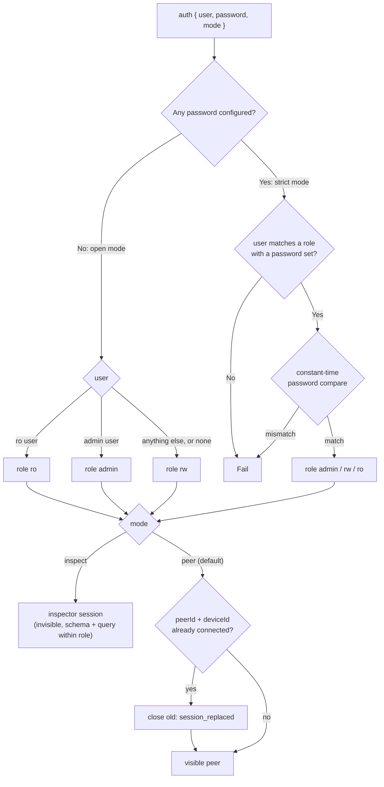

# Auth & Roles

`src/server/auth.ts`. Settings are in [Configuration](../2-server/configuration.md#credentials).

---

## 1. Credential Verification

- Users and passwords come from `P2P_{ADMIN,RW,RO}_{USER,PASSWORD}`. In strict mode (at least one password set), a role whose password is unset is disabled.
- Comparison is constant-time: the Server computes `sha256(candidate)` and `sha256(configured)` and compares them with `crypto.timingSafeEqual`, so neither the length nor the content of the password leaks through timing. The username lookup is a plain map lookup (usernames are not secret).
- A failed attempt gets `close { reason: "auth_failed" }`, with the same message whether the user is unknown, the role disabled, or the password wrong.
- Each failure is logged at `warn` with the user, never the password.

## 2. Open Mode

With no `P2P_*` variable at all, the Server starts ready to tinker with, develop against and test: no password is set, so it runs in open mode.

- Every client is accepted, with or without `user` / `password`, with full permissions: role `rw`.
- The usernames `P2P_RO_USER` (`ro`) and `P2P_ADMIN_USER` (`admin`) still select those roles, so spectators and admins can be tried out: `{ user: "ro" }` gives a read-only client. Passwords are ignored.
- The Server logs a warning at startup.

Setting any one of `P2P_ADMIN_PASSWORD`, `P2P_RW_PASSWORD` or `P2P_RO_PASSWORD` switches to **strict mode**: only roles with a password exist, and every client must present matching credentials. Use strict mode for anything reachable by others (staging, live). Every other setting (limits, heartbeat, ICE servers, usernames) is optional in both modes.

## 3. Permissions

Roles say what a session may do; the session mode says how it takes part. A visible peer of any role takes part in the room; an [inspector session](inspection.md#1-inspector-sessions) only inspects, within its role.

| Operation                                            | `admin` | `rw` |                  `ro`                  |          Inspector (any role)          |
| :--------------------------------------------------- | :-----: | :--: | :------------------------------------: | :------------------------------------: |
| Listed in `peers`, `peer:joined` / `peer:left`       |    ✓    |  ✓   |                   ✓                    |                   ✗                    |
| Receive presence, broadcasts, direct messages, state |    ✓    |  ✓   |                   ✓                    |                   ✗                    |
| `getActivePeers`, `getState`                         |    ✓    |  ✓   |                   ✓                    |            ✗ (use `query`)             |
| `presence` (update own meta)                         |    ✓    |  ✓   |              `READ_ONLY`               |              `FORBIDDEN`               |
| `send`, `broadcast`, `request`                       |    ✓    |  ✓   |              `READ_ONLY`               |              `FORBIDDEN`               |
| `reply` to a request it received                     |    ✓    |  ✓   |                   ✓                    |       n/a (receives no requests)       |
| Be the target of `send` / `request`                  |    ✓    |  ✓   | `send` ✓, `request` `TARGET_READ_ONLY` |          ✗ (`PEER_NOT_FOUND`)          |
| `state:set`, `state:delete`, `state:clear`           |    ✓    |  ✓   |              `READ_ONLY`               |              `FORBIDDEN`               |
| `media:chunk`, `media:end` (share media)             |    ✓    |  ✓   |              `READ_ONLY`               |              `FORBIDDEN`               |
| `signal` (links)                                     |    ✓    |  ✓   |      ✓ (with non-`ro` peers only)      |              `FORBIDDEN`               |
| `schema`, `query` reads                              |    ✓    |  ✓   |                   ✓                    |                   ✓                    |
| `query` writes                                       |    ✓    |  ✓   |              `READ_ONLY`               | ✓ for `admin` / `rw`, else `READ_ONLY` |

- `admin` has the same permissions as `rw`. It is a separate credential for operators and tooling, so it can be rotated or withheld without touching the credentials applications use.
- The Server checks the role on every frame before any other processing. A rejected frame gets `error { code }` and changes nothing; the session continues.
- The Client checks its own role first and rejects with the same `P2PError` without sending, so a spectator UI fails fast and identically whether the check happened locally or on the Server.
- `READ_ONLY` messages are exactly `Read-only client cannot publish or mutate state`.
- Spectators can still form links with `rw` and `admin` peers, so they receive media tracks and link-delivered frames. Honest Clients drop publishing frames that arrive over a link from an `ro` peer (see [Architecture](../1-concepts/architecture.md#6-trust-boundaries)).

## 4. Test Contract

`test/rbac.test.ts` and `test/auth.test.ts` cover: every cell of the table above; open mode (everyone accepted as rw, `ro` / `admin` usernames select those roles, no credentials needed); one password switching to strict mode; a disabled role; wrong password and unknown user giving identical closes; inspector sessions of each role absent from `peers` and presence events and receiving no relays; `READ_ONLY` raised locally without a frame reaching the Server. Identity rules (replacement) are covered by `test/multi-device.test.ts` (see [Room](room.md#7-test-contract)).
