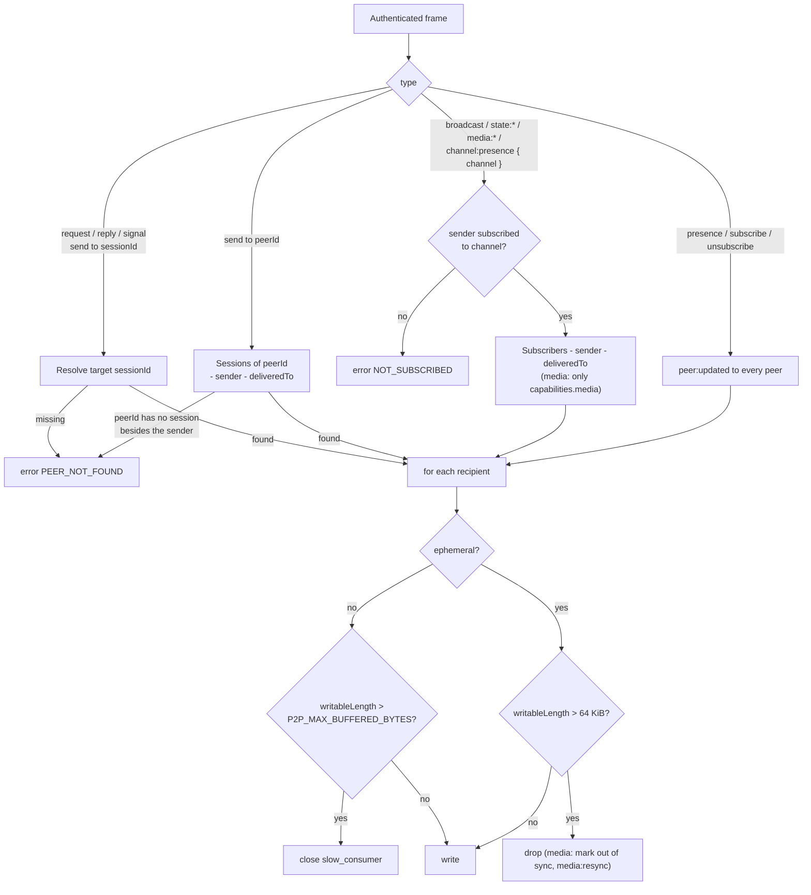

# Presence & Channels

`src/server/registry.ts` (peers, presence, relays, backpressure) and `src/server/channels.ts` (channels and subscriptions). Frames are defined in the [Protocol Spec](../1-concepts/protocol-spec.md).

---

## 1. Why Channels

Everything a Server carries falls into two scopes:

- **Global**: who is connected (every device, with its global `meta` and the channels it is subscribed to), which channels exist, direct messages and requests. Small, and useful to every screen of an application.
- **Channel**: shared state, broadcasts (cursors, live strokes), channel presence (a viewport) and media. Potentially large and continuous, and useful only to the screen showing that channel.

A project with a list of boards subscribes to nothing while it shows the list: it sees every board (the channel list) and who is on which one (each peer's `channels`) without receiving a single stroke. Opening board A subscribes to `board:A` and streams only board A. Channels exist to spare Clients data they do not need; they are not an access control mechanism (see [Architecture › Trust Boundaries](../1-concepts/architecture.md#6-trust-boundaries)).

## 2. Registry

- The Server holds `Map<sessionId, Member>` for visible peers, `Map<peerId, Set<sessionId>>` (one user's devices), the inspector sessions, the channels, the store and the counters.
- **Many sessions per `peerId`.** A `peerId` maps to every visible session of that user: one per device. They are independent peers, each with its own subscriptions.
- **Replacement by device.** When a session authenticates with a `peerId` and `deviceId` pair already present, the older session is closed with `session_replaced` (with `subscriber:left` in its channels and `peer:left`) before `peer:joined { replaces }` for the new one. This lets a Client that reconnects before the Server noticed the drop take its device's place back immediately, while the user's other devices are untouched. The new session starts with no subscriptions; its Client subscribes again.
- **Return after a drop.** The Server remembers, for 60 s, each visible session that ended with a reason other than `client_close`: its `sessionId` and channels, keyed by `peerId` and `deviceId`. A new session of that device within the window gets `peer:joined { replaces }` as if it had replaced a live one.
- **`replaces` in channels.** A session that replaced another (live or remembered) keeps the set of channels the old one was in. Its first subscribe to each of them sends `subscriber:joined { replaces }`, so the channel's subscribers can tell a device coming back from a new arrival without timers.
- **Device labels.** At authentication the Server compares the requested `deviceLabel` with the labels of the user's other live sessions and appends ` 2`, ` 3`, … when it is taken. `connected.deviceLabel` tells the Client which label it got.
- Inspector sessions receive global presence and channel events but trigger none, cannot be targeted, and receive channel traffic only for their subscriptions (§4).

## 3. Global Presence

| Event             | Trigger                                                                                       | Recipients                                            |
| :---------------- | :-------------------------------------------------------------------------------------------- | :---------------------------------------------------- |
| `peer:joined`     | Visible session authenticated (`replaces` set when it took over a device's previous session). | Every other peer, including the user's other devices. |
| `peer:updated`    | Accepted `presence`, `subscribe` or `unsubscribe`, or one of its channels was deleted.        | Every other peer.                                     |
| `peer:left`       | Session closed for any reason (§7 of the Protocol Spec).                                      | Every other peer.                                     |
| `channel:created` | A channel was created.                                                                        | Every peer, the creator included.                     |
| `channel:updated` | A channel's `meta` changed (`query updateChannel`).                                           | Every peer, the writer included.                      |
| `channel:deleted` | A channel was deleted.                                                                        | Every peer, the deleter included.                     |

Inspector sessions receive all of these too.

`peer:left` is emitted once per session, from the socket's `close` handler, whatever closed it (heartbeat, `bye`, error, replacement, shutdown).

## 4. Channels

### Lifecycle

- A channel is created by an `rw` or `admin` session, with `subscribe { create }` or the `query` operation `createChannel`. It records `{ id, createdAt, createdBy, meta }`. Creating an existing channel is not an error (`created: false`).
- Its `meta` (at most 4 KiB of JSON) is what a channel list needs: a title, a description. `rw` and `admin` sessions patch it with `query updateChannel`, which announces `channel:updated` with the new `ChannelInfo`. It is stored with the channel, so it can never exist without it or outlive it.
- It exists, with or without subscribers, until `query deleteChannel`, allowed to its creator (any device of the `createdBy` user, while not `ro`) and to `admin` sessions. Deleting drops its state and `meta`, unsubscribes its subscribers and announces `channel:deleted`.
- Channels and their state are persisted together in the snapshot ([State Store](state-store.md#6-snapshot-format)), so a Server restart keeps them.
- At most `P2P_MAX_CHANNELS` channels exist at once; creating one more fails with `CHANNEL_LIMIT`.

### Subscriptions

- Each member keeps `Map<channel, meta>` of its subscriptions; each channel keeps the set of its subscribers.
- `subscribe` answers with every other subscriber's `{ sessionId, meta }` and the channel's whole state, then sends `peer:updated` to everyone and `subscriber:joined` to the channel's other subscribers. Subscribing again to the same channel replaces the channel `meta` (as `subscriber:updated`) and returns a fresh snapshot.
- `unsubscribe` sends `subscriber:left { reason: "unsubscribed" }`, then `peer:updated`.
- `subscribe { replace }` switches channels: `subscriber:left` in the old one, one `peer:updated`, `subscriber:joined` in the new one, after checking both.
- A session closing sends `subscriber:left { reason }` in each of its channels, then `peer:left`.
- A member subscribes to at most `P2P_MAX_CHANNELS_PER_SESSION` channels (`CHANNEL_LIMIT`).
- Role `ro` subscribes to existing channels only (`CHANNEL_NOT_FOUND` without `create`, `FORBIDDEN` with it). Once subscribed, every role has the same rights in the channel.

### Inspector Subscriptions

- An inspector's exact subscriptions are kept apart from the channel's subscribers: they are never announced, listed or counted, and are exempt from `P2P_MAX_CHANNELS_PER_SESSION`.
- An inspector's prefix watches are a set of prefixes on its session. Every channel frame is delivered to the channel's subscribers, its inspector subscribers and the inspectors with a matching prefix, each once.
- Inspectors have no media capability, so media frames never reach them.
- A channel is **observed** while at least one inspector subscription or watch matches it. Its visible subscribers get `observed` in the subscribe ack and `channel:observed` when it changes, and then send their broadcasts to the Server even when every subscriber is linked (with all of them in `deliveredTo`), so the inspectors receive them. They are never told who observes.
- Deleting a channel drops inspector subscriptions to it; prefix watches stay and match channels created later.

### Leases

`src/server/leases.ts`. Each channel keeps, in memory, `Map<name, { holder, expiresAt, queue }>`:

- `lease` grants a free lease (or renews the caller's) and arms a timer for `ttlMs`; a taken lease answers `granted: false` and, with `wait`, appends the caller to the queue once.
- When the holder releases, lets the timer run out, unsubscribes or disconnects, the lease passes to the first queued session that is still subscribed, with the `ttlMs` it asked for. One `lease:changed` announces the new holder (or `null`) to the channel's audience.
- A session leaving the channel also leaves every queue there. Deleting the channel drops its leases without announcements (its subscribers close the channel).
- The subscribe ack carries the current holders, so a late subscriber knows who does each job.

### Channel Stats

`src/server/stats.ts`. Each session keeps a set of followed prefixes. After a stored write or clear in a channel (peer frames and `query` writes alike), the Server sends `channel:stats` to every session following a matching prefix, at most once per second per channel: the first write of a quiet period is reported at once, later ones are coalesced into one report at the end of the second. A Server without followers does no work.

### Channel Presence

`channel:presence { channel, meta }` replaces the sender's `meta` in that channel (or patches it with `merge: true`) and sends `subscriber:updated`, with the whole resulting `meta`, to the channel's other subscribers. With `ephemeral: true` it has no `ack` and the `subscriber:updated` is dropped for a recipient above the backpressure threshold, like an ephemeral broadcast, while the Server keeps the latest `meta` for later subscribers. That gives fast-changing presence (a cursor, a viewport during a drag) one path: ephemeral updates while it moves, then one acknowledged update when it settles so every subscriber converges. It is the place for per-channel, frequently changing information (a viewport, a selection, the tool in use on this board) that only that channel's subscribers need. Global `presence` is for information about the device everyone may need (a name color, a status).

## 5. Relaying

- **Session frames** (`request`, `reply`, `signal`, and `send` with `to: { sessionId }`) go to one visible peer, else `PEER_NOT_FOUND`. Channels play no part.
- **User frames** (`send` with `to: { peerId }`) go to every session of that `peerId` except the sender and `deliveredTo`. `PEER_NOT_FOUND` only when the `peerId` has no session other than the sender; when every target was already in `deliveredTo` the `ack` is sent with nothing written. Sending to one's own `peerId` reaches one's other devices.
- **Channel frames** (`broadcast`, accepted `state:*`, `state:live`, `media:chunk`, `media:end`) go to every subscriber of the frame's `channel` except the sender and the `sessionId`s in `deliveredTo`. The sender must be subscribed (`NOT_SUBSCRIBED`). Entries of `deliveredTo` that are not subscribers are ignored.
- `media:chunk` and `media:end` go only to subscribers whose `capabilities.media` is `true`.
- The Server encodes a relayed frame once with `from` set and writes the same bytes to every recipient.
- `ack` for `send` / `broadcast` / `request` is sent after the relay writes are queued. It means "routed", not "processed by the recipient".
- **Reply authorization.** The Server remembers, per session, the `msgId`s of requests relayed to it (pruned when they reach their `timeoutMs`). A `reply` whose `replyTo` is not in that set is rejected with `INVALID_ARGUMENT`.

## 6. Backpressure

- Threshold: the recipient socket's `writableLength` above 65 536 bytes.
- Ephemeral `send` / `broadcast` / `channel:presence` / `state:live` above the threshold: dropped for that recipient and counted in `stats.droppedEphemeral`.
- `media:chunk` with `init: false` above the threshold: dropped, and the recipient is marked out of sync for `(sender, streamId)`. Later chunks of that stream are dropped for it until one with `init: true`. The sender gets one `media:resync { channel, streamId, from: recipient }` per out-of-sync episode.
- `media:chunk` with `init: true` is never dropped for backpressure (it is what resynchronizes a receiver); it clears the out-of-sync mark.

### Slow Consumers

Reliable frames are never dropped. A recipient whose `writableLength` exceeds `P2P_MAX_BUFFERED_BYTES` (8 MiB by default) is closed with `slow_consumer` instead of letting the Server's memory grow without bound.

## 7. Links Report

`link { to, mode }` frames update `member.links[to] = mode`. The Server uses them only for `schema` output and the `relayedFrames` / `skippedByDeliveredTo` counters; routing always follows `deliveredTo`.

## 8. Counters

Exposed by [`schema`](inspection.md): `relayedFrames`, `skippedByDeliveredTo` (recipients not written because they were in `deliveredTo`), `droppedEphemeral`, `droppedMediaChunks`, `mediaResyncs`, and `closeReasons` (ended sessions per close reason), plus the last 50 closes in `recentCloses`. The integration tests use them to prove that frames between linked peers bypass the Server.

## 9. Test Contract

`test/presence-messaging.test.ts`, `test/channels.test.ts`, `test/multi-device.test.ts`, `test/fallback-transport.test.ts`: join/update/leave ordering; `peer:updated` with `channels` on subscribe and unsubscribe; channel creation by `rw`, `CHANNEL_NOT_FOUND` / `FORBIDDEN` for `ro`, deletion with `channel:deleted`; a peer receiving nothing from channels it is not subscribed to; `NOT_SUBSCRIBED`; `CHANNEL_LIMIT` per session and per Server; channel presence seen only by subscribers; three devices of one `peerId` coexisting with independent `meta` and subscriptions; replacement only on the same `deviceId`, with `peer:left` before `peer:joined { replaces }`; `replaces` after a drop within the window and in `subscriber:joined`; switching channels with one `peer:updated`; merged and ephemeral channel presence; channel `meta` and deletion rights; device label suffixes; leases (grant, queue, renewal, expiry, hand-over on leave and disconnect, `lease:changed`); stats follows and their once-per-second pace; `send` to a `peerId` reaching every device whatever its channels, to one's own `peerId` reaching only the other devices, and to `{ sessionId }` reaching one; `deliveredTo` exclusion and unknown entries; inspector sessions receiving nothing; `PEER_NOT_FOUND`; replies allowed only for a received request; ephemeral drops above 64 KiB with a paused reader; media out-of-sync and `media:resync`; `slow_consumer`.
