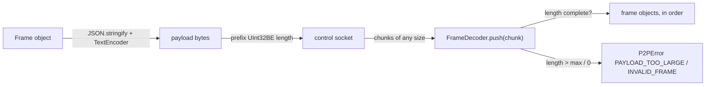

# Codec



`src/protocol/codec.ts` is shared by the Server and the Client, so it uses `Uint8Array`, `DataView`, `TextEncoder` and `TextDecoder` only (no `Buffer`). The wire format is defined in [Protocol Spec](../1-concepts/protocol-spec.md#1-framing).

---

## API

```typescript
export function encodeFrame(frame: Frame, maxPayloadBytes: number): Uint8Array;
export function encodeLinkMessage(frame: Frame): string;
export function decodeLinkMessage(message: string): Frame;

export class FrameDecoder {
    constructor(maxPayloadBytes: number);
    push(chunk: Uint8Array): Frame[];
    get bufferedBytes(): number;
}
```

| Function / Member   | Behavior                                                                                                                                                                                                                         |
| :------------------ | :------------------------------------------------------------------------------------------------------------------------------------------------------------------------------------------------------------------------------- |
| `encodeFrame`       | Returns `[length][payload]` in one buffer (one `socket.write` per frame). Throws `P2PError("PAYLOAD_TOO_LARGE")` when the payload exceeds `maxPayloadBytes`.                                                                     |
| `encodeLinkMessage` | `JSON.stringify(frame)`: the DataChannel form, no prefix.                                                                                                                                                                        |
| `decodeLinkMessage` | Parses one DataChannel message. Throws `P2PError("INVALID_FRAME")` on bad JSON or a missing `type`.                                                                                                                              |
| `FrameDecoder.push` | Appends a chunk and returns every frame it completes, in order. Handles a header split across chunks, several frames in one chunk, and a payload split across many chunks. Never copies a complete frame's bytes more than once. |
| Length checks       | A length of `0` throws `INVALID_FRAME`; a length over `maxPayloadBytes` throws `PAYLOAD_TOO_LARGE` as soon as the 4 header bytes are read, before buffering the payload.                                                         |
| `bufferedBytes`     | Bytes held for an incomplete frame (tests, diagnostics).                                                                                                                                                                         |

After the decoder throws, the stream is unusable: the Server closes the socket with the matching close reason, and the Client treats it as `connection_lost`.

## Validation

The codec checks framing and JSON only. Field validation (types, lengths, `msgId` prefix, roles) belongs to the receiver: `server/session.ts` for control sockets and `client/router.ts` for links.

## Test Contract

`test/codec.test.ts` covers: round trip of every frame type; byte-by-byte delivery; many frames in one chunk; a 1 MiB payload at the limit and one byte over; length `0`; invalid UTF-8 and invalid JSON; a missing `type`; DataChannel round trip.
