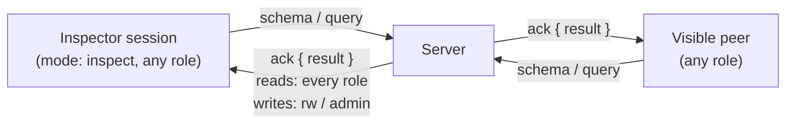

# Inspection: `schema` & `query`



`src/server/inspect.ts`. Roles are described in [Auth & Roles](auth.md).

`schema` and `query` let tools look at and edit the room without being part of it: a data explorer, an admin console, a CLI, a test. They run with the caller's own role, so a tool connected with `ro` credentials can browse everything and change nothing, exactly like an `ro` peer.

---

## 1. Inspector Sessions

A session opened with `mode: "inspect"`, with any role:

- is not a peer: not listed in `peers`, no `peer:joined` / `peer:left`, cannot be the target of `send` or `request`;
- receives no relayed traffic (no presence, messages, state changes or media) and its `connected` frame has `peers: []` and `state: {}`;
- never forms links;
- may only send `schema`, `query`, `ping` and `bye`; any peer frame gets `FORBIDDEN`;
- is attributed as `peer.id` (when given in `auth`) or `inspect:<sessionId>` in the `updatedBy` of its query writes and in the `from` of its query messages. Receivers that cannot resolve the sender's `sessionId` to a listed peer report it as `{ peerId, sessionId, role, inspector: true }`.

Inspector sessions count toward `P2P_MAX_CONNECTIONS`.

Visible peers may run `schema` and `query` too; the rules below are the same for them.

## 2. `schema`

`p2p.getSchema()` sends `schema { reqId }`. Every role may run it. The `ack` carries:

```json
{
    "storageBytes": 18234,
    "maxStateBytes": 67108864,
    "connections": 4,
    "maxConnections": 256,
    "userCount": 2,
    "peerCount": 3,
    "peers": [
        {
            "peerId": "usr_alice",
            "sessionId": "q0sJ3m9xZ2V4yB7nT1uKpA",
            "deviceId": "d-7f2c41e9b0",
            "name": "Alice",
            "role": "rw",
            "capabilities": { "webrtc": true, "media": true },
            "connectedAt": 1792000000000,
            "links": { "Zb1...": "webrtc", "Kx9...": "socket" },
            "socketWritableBytes": 0
        }
    ],
    "inspectorCount": 1,
    "stateKeyCount": 2,
    "stateKeys": [
        {
            "key": "shape:1",
            "type": "object",
            "sizeBytes": 41,
            "updatedBy": "usr_alice",
            "updatedAt": 1792000000000
        }
    ],
    "stats": {
        "relayedFrames": 1203,
        "skippedByDeliveredTo": 4410,
        "droppedEphemeral": 12,
        "droppedMediaChunks": 0,
        "mediaResyncs": 0
    }
}
```

- `peerCount` counts visible sessions (devices); `userCount` counts distinct `peerId`s.
- `storageBytes` is the snapshot size; `maxStateBytes` and `maxConnections` echo the configured limits; `connections` counts every authenticated session, inspectors included.
- `stateKeys` lists up to 1 000 live keys (by key order; `stateKeyCount` is the total); `type` is `"object"`, `"array"`, `"string"`, `"number"`, `"boolean"` or `"null"`. Use `query getState` to page further.
- `links` is what each peer reported with `link` frames.

## 3. `query`

`p2p.query({ operation, ... })` sends `query { reqId, operation, ... }` and resolves with `ack.result`.

| Operation                                                  | Roles         | Result                                                                                                                                                                                                  |
| :--------------------------------------------------------- | :------------ | :------------------------------------------------------------------------------------------------------------------------------------------------------------------------------------------------------ |
| `{ operation: "peers", peerId? }`                          | all           | `PeerInfo[]` of visible peers, optionally one user's devices.                                                                                                                                           |
| `{ operation: "getState", key?, prefix?, after?, limit? }` | all           | `{ entries: { [key]: Entry }, next? }`: live entries in key order. `key` returns at most one; `prefix` filters; `limit` defaults to 100, max 1 000; `next` is the `after` value for the following page. |
| `{ operation: "setState", key, value }`                    | `admin`, `rw` | `{ applied: true, entry }`. The Server assigns the version (`[clock + 1, caller sessionId]`).                                                                                                           |
| `{ operation: "deleteState", key }`                        | `admin`, `rw` | `{ applied: true, entry }` (the tombstone).                                                                                                                                                             |
| `{ operation: "clearState", prefix? }`                     | `admin`, `rw` | `{ applied: true, count }`. With `prefix`, only matching keys.                                                                                                                                          |
| `{ operation: "broadcast", data }`                         | `admin`, `rw` | `{ recipients: number }`. Relayed to every peer (no `deliveredTo`).                                                                                                                                     |
| `{ operation: "send", to, data }`                          | `admin`, `rw` | `{ recipients: number }`. `to` is `{ peerId }` (every device of that user) or `{ sessionId }`; `PEER_NOT_FOUND` when nobody matches.                                                                    |

- `ro` sessions get `READ_ONLY` for writes, with the same message as for peer frames.
- An unknown `operation` or a missing field gets `INVALID_ARGUMENT`.
- Query writes go through the same store, relays and limits as peer frames (`STATE_TOO_LARGE`, key rules), and peers see them as ordinary `state:changed`, `state:cleared` and `message` events.
- `query` is how a Client without a replica (a script, a CLI, a data explorer) reads and writes state in one round trip with no clock bookkeeping.

## 4. Test Contract

`test/inspect-query.test.ts`: inspector sessions of each role are invisible, receive nothing and get `FORBIDDEN` for peer frames; `schema` fields; `userCount` vs `peerCount` with one user on several devices; every operation for every role; `getState` paging (`limit`, `after`, `next`) and `prefix`; `clearState` with `prefix`; server-assigned versions winning over older Client writes; query writes observed as ordinary events by peers with the inspector's attribution; counters increasing as documented.
