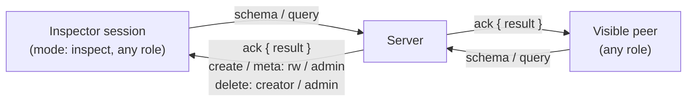

# Inspection: `schema` & `query`



`src/server/inspect.ts`. Roles are described in [Auth & Roles](auth.md).

`schema` and `query` let tools look at and edit the Server without taking part in it: a data explorer, an admin console, a CLI, a test. They reach every channel without subscribing, in one round trip each, and run with the caller's own role: an `ro` tool reads and writes existing channels but cannot create one, change its `meta` or delete it.

---

## 1. Inspector Sessions

A session opened with `mode: "inspect"`, with any role:

- is not a peer: not listed in `peers`, no `peer:joined` / `peer:left`, cannot be the target of `send` or `request`;
- sees what every peer sees globally: its `connected` frame lists the peers and channels, and it receives `peer:*` and `channel:*` events from then on;
- may subscribe to channels, by id or by prefix, without appearing anywhere and without the per-session channel limit ([Protocol Spec §5.1.2](../1-concepts/protocol-spec.md#512-inspector-subscriptions)); it then receives that channel traffic, media excepted;
- never forms links and receives no direct messages;
- may only send `schema`, `query`, `subscribe`, `unsubscribe`, `ping` and `bye`; any other peer frame gets `FORBIDDEN`. It writes through `query` only;
- is attributed as `peer.id` (when given in `auth`) or `inspect:<sessionId>` in the `updatedBy` of its query writes, in `createdBy`, and in the `from` of its query messages; its `deviceId` is its `sessionId`. Receivers that cannot resolve the sender's `sessionId` to a listed peer report it as `{ peerId, sessionId, role, inspector: true }`.

This makes an inspector session the right shape for monitors, loggers and bots: they see every channel they watch, and nobody has to filter them out of presence.

Inspector sessions count toward `P2P_MAX_CONNECTIONS`.

Visible peers may run `schema` and `query` too; the rules below are the same for them.

## 2. `schema`

`p2p.getSchema()` sends `schema { reqId }`. Every role may run it. The `ack` carries the Server's overview:

```json
{
    "storageBytes": 18234,
    "maxStateBytes": 67108864,
    "connections": 4,
    "maxConnections": 256,
    "userCount": 2,
    "peerCount": 3,
    "peers": [
        {
            "peerId": "usr_alice",
            "sessionId": "q0sJ3m9xZ2V4yB7nT1uKpA",
            "deviceId": "d-7f2c41e9b0",
            "name": "Alice",
            "role": "rw",
            "capabilities": { "webrtc": true, "media": true },
            "channels": ["board:A"],
            "connectedAt": 1792000000000,
            "links": { "Zb1...": "webrtc", "Kx9...": "socket" },
            "socketWritableBytes": 0
        }
    ],
    "inspectorCount": 1,
    "channelCount": 2,
    "maxChannels": 1024,
    "channels": [
        {
            "id": "board:A",
            "createdAt": 1792000000000,
            "createdBy": "usr_alice",
            "meta": { "title": "Roadmap" },
            "subscriberCount": 2,
            "keyCount": 14,
            "sizeBytes": 9120
        }
    ],
    "stats": {
        "relayedFrames": 1203,
        "skippedByDeliveredTo": 4410,
        "droppedEphemeral": 12,
        "droppedMediaChunks": 0,
        "mediaResyncs": 0,
        "closeReasons": { "client_close": 31, "connection_lost": 4, "session_replaced": 2 }
    },
    "recentCloses": [
        {
            "at": 1792000000000,
            "reason": "connection_lost",
            "peerId": "usr_bob",
            "deviceId": "d-3c55a0f2e1",
            "sessionId": "Zb1...",
            "mode": "peer"
        }
    ]
}
```

- `peerCount` counts visible sessions (devices); `userCount` counts distinct `peerId`s.
- `storageBytes` is the snapshot size; `maxStateBytes`, `maxConnections` and `maxChannels` echo the configured limits; `connections` counts every authenticated session, inspectors included.
- `channels` lists every channel in id order with its live key count and serialized size.
- `links` is what each peer reported with `link` frames.
- `stats.closeReasons` counts ended sessions by close reason since the Server started; `recentCloses` lists the last 50, newest first. Several devices closing in the same second with `connection_lost` points at the network between them and the Server; `server_shutdown` at a restart.

`p2p.getSchema("board:A")` sends `schema { reqId, channel }` and gets one channel's detail (`CHANNEL_NOT_FOUND` when it does not exist):

```json
{
    "id": "board:A",
    "createdAt": 1792000000000,
    "createdBy": "usr_alice",
    "meta": { "title": "Roadmap" },
    "sizeBytes": 9120,
    "subscribers": [{ "sessionId": "q0sJ3m9xZ2V4yB7nT1uKpA", "peerId": "usr_alice", "meta": {} }],
    "keyCount": 14,
    "keys": [
        {
            "key": "stroke:1",
            "type": "object",
            "sizeBytes": 41,
            "updatedBy": "usr_alice",
            "updatedAt": 1792000000000
        }
    ],
    "stats": {
        "keyCount": 14,
        "stateBytes": 9120,
        "subscriberCount": 1,
        "lastWriteAt": 1792000000000,
        "lastWriteBy": "usr_alice"
    }
}
```

`keys` lists up to 1 000 live keys in key order (`keyCount` is the total); `type` is `"object"`, `"array"`, `"string"`, `"number"`, `"boolean"` or `"null"`. Use `query getState` to page further.

## 3. `query`

`p2p.query({ operation, ... })` sends `query { reqId, operation, ... }` and resolves with `ack.result`.

| Operation                                                                  | Roles            | Result                                                                                                                                                                                                                                                                                                                                          |
| :------------------------------------------------------------------------- | :--------------- | :---------------------------------------------------------------------------------------------------------------------------------------------------------------------------------------------------------------------------------------------------------------------------------------------------------------------------------------------- |
| `{ operation: "peers", peerId?, channel? }`                                | all              | `PeerInfo[]` of visible peers, optionally one user's devices and/or one channel's subscribers.                                                                                                                                                                                                                                                  |
| `{ operation: "channels", prefix? }`                                       | all              | `ChannelInfo[]` in id order, optionally the ids starting with `prefix`.                                                                                                                                                                                                                                                                         |
| `{ operation: "createChannel", channel, meta? }`                           | `admin`, `rw`    | `{ created: boolean, channel: ChannelInfo }`. `created: false` when it already existed (`meta` is then ignored).                                                                                                                                                                                                                                |
| `{ operation: "updateChannel", channel, meta }`                            | `admin`, `rw`    | `{ channel: ChannelInfo }`. `meta` is a patch ([Protocol Spec §4.3](../1-concepts/protocol-spec.md#43-meta-patches)); sends `channel:updated`.                                                                                                                                                                                                  |
| `{ operation: "deleteChannel", channel }`                                  | creator, `admin` | `{ deleted: true }`. Drops the channel's state and `meta`, unsubscribes its subscribers, sends `channel:deleted`.                                                                                                                                                                                                                               |
| `{ operation: "getState", channel, key?, keys?, prefix?, after?, limit? }` | all              | `{ entries: { [key]: Entry }, next?, stats }`: live entries in key order. `key` returns at most one, `keys` (up to 1 000) only those; `prefix` filters; `limit` defaults to 100, max 1 000; `next` is the `after` value for the following page. `stats` is the channel's `{ keyCount, stateBytes, subscriberCount, lastWriteAt, lastWriteBy }`. |
| `{ operation: "getStates", channels, keys?, prefix?, limit? }`             | all              | `{ [id]: { entries, next?, stats } }`: `getState` for up to 100 channels in one round trip. Missing channels are left out (no error).                                                                                                                                                                                                           |
| `{ operation: "stats", channels?, prefix? }`                               | all              | `{ [id]: stats }` for the listed channels (up to 1 000), or every channel whose id starts with `prefix` (default: all).                                                                                                                                                                                                                         |
| `{ operation: "setState", channel, key, value, tag? }`                     | all              | `{ applied: true, entry }`. The Server assigns the version (`[clock + 1, caller sessionId]`).                                                                                                                                                                                                                                                   |
| `{ operation: "deleteState", channel, key, tag? }`                         | all              | `{ applied: true, entry }` (the tombstone).                                                                                                                                                                                                                                                                                                     |
| `{ operation: "clearState", channel, prefix?, tag? }`                      | all              | `{ applied: true, count }`. With `prefix`, only matching keys.                                                                                                                                                                                                                                                                                  |
| `{ operation: "broadcast", channel, data }`                                | all              | `{ recipients: number }`. Relayed to every subscriber of the channel (no `deliveredTo`).                                                                                                                                                                                                                                                        |
| `{ operation: "send", to, data }`                                          | all              | `{ recipients: number }`. `to` is `{ peerId }` (every device of that user) or `{ sessionId }`; `PEER_NOT_FOUND` when nobody matches.                                                                                                                                                                                                            |

- Operations that take `channel` fail with `INVALID_CHANNEL` for a malformed id and `CHANNEL_NOT_FOUND` for a missing channel (except `createChannel`). They never create a channel implicitly.
- `ro` sessions get `FORBIDDEN` for `createChannel`, `updateChannel` and `deleteChannel`; `rw` sessions get it for `deleteChannel` on a channel another user created.
- An unknown `operation` or a missing field gets `INVALID_ARGUMENT`.
- Query writes go through the same store, relays and limits as peer frames (`STATE_TOO_LARGE`, key rules), and subscribers see them as ordinary `state:changed`, `state:cleared` and `message` events.
- `query` is how a Client reads or writes a channel it is not subscribed to (a script, a CLI, a data explorer, a board list that peeks at one key), in one round trip with no clock bookkeeping. It runs on peer sessions as well as inspector sessions; `p2p.peek(channel, opts)` is `getState` with a typed result, and does not count toward the channel limit.
- `lastWriteAt` and `lastWriteBy` come from the newest entry of the channel, tombstones included (a fresh Server computes them from the snapshot); `null` when the channel was never written.

## 4. Test Contract

`test/inspect-query.test.ts`, `test/observers.test.ts`, `test/channel-stats.test.ts`: `getStates` and `stats` (by list and prefix, missing channels left out); inspector sessions of each role are invisible, receive global presence but no direct messages, and get `FORBIDDEN` for the peer frames they may not send; exact and prefix subscriptions that receive channel traffic without appearing in presence or counting toward the limit; channel `meta` on create and `updateChannel`; deletion by the creator or an admin only; `stats` in `getState` and `schema`; close reason counters and `recentCloses`; `schema` fields, with and without `channel`; `userCount` vs `peerCount` with one user on several devices; every operation for every role; `CHANNEL_NOT_FOUND` and `INVALID_CHANNEL`; `getState` paging (`limit`, `after`, `next`) and `prefix`; `clearState` with `prefix`; server-assigned versions winning over older Client writes; query writes observed as ordinary events by subscribers with the inspector's attribution, and not by other peers; counters increasing as documented.
