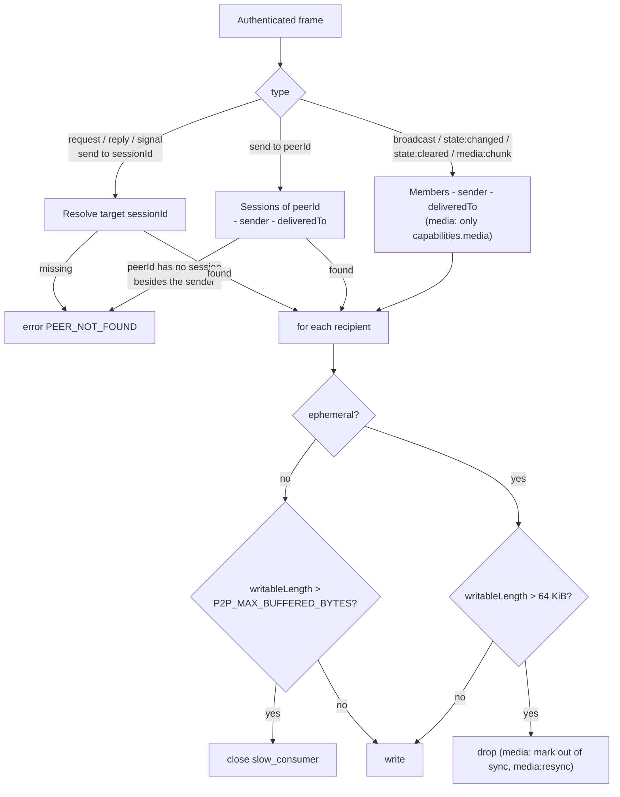

# Room

`src/server/room.ts`. Frames are defined in the [Protocol Spec](../1-concepts/protocol-spec.md).

---

## 1. Registry

- The Server has exactly one `Room`. It holds `Map<sessionId, Session>` for visible peers, `Map<peerId, Set<sessionId>>` (one user's devices), the inspector sessions, the store and the counters.
- Every authenticated peer session joins it; there is nothing to choose or route. The state outlives the sessions in the store and the snapshot, so the room keeps its state while empty.
- **Many sessions per `peerId`.** A `peerId` maps to every visible session of that user: one per device. They are independent peers.
- **Replacement by device.** When a session authenticates with a `peerId` and `deviceId` pair already present, the older session is closed with `session_replaced` and `peer:left` is sent for it before `peer:joined { replaces }` for the new one. This lets a Client that reconnects before the Server noticed the drop take its device's place back immediately, while the user's other devices are untouched.
- Inspector sessions are tracked only for `schema`; they receive no relays, trigger no presence events, and cannot be targeted.

## 2. Presence

| Event          | Trigger                                                                                       | Recipients                                            |
| :------------- | :-------------------------------------------------------------------------------------------- | :---------------------------------------------------- |
| `peer:joined`  | Visible session authenticated (`replaces` set when it took over a device's previous session). | Every other peer, including the user's other devices. |
| `peer:updated` | Accepted `presence` frame.                                                                    | Every other peer.                                     |
| `peer:left`    | Session closed for any reason (§6 of the Protocol Spec).                                      | Every other peer.                                     |

`peer:left` is emitted once per session, from the socket's `close` handler, whatever closed it (heartbeat, `bye`, error, replacement, shutdown).

## 3. Relaying

- **Session frames** (`request`, `reply`, `signal`, and `send` with `to: { sessionId }`) go to one visible peer, else `PEER_NOT_FOUND`. `request` to an `ro` target fails with `TARGET_READ_ONLY`.
- **User frames** (`send` with `to: { peerId }`) go to every session of that `peerId` except the sender and `deliveredTo`. `PEER_NOT_FOUND` only when the `peerId` has no session other than the sender; when every target was already in `deliveredTo` the `ack` is sent with nothing written. Sending to one's own `peerId` reaches one's other devices.
- **Room frames** (`broadcast`, accepted `state:*`, `media:chunk`, `media:end`) go to every visible peer except the sender and the `sessionId`s in `deliveredTo`. Entries of `deliveredTo` that are not peers are ignored.
- `media:chunk` and `media:end` go only to peers whose `capabilities.media` is `true`.
- The Room re-encodes the frame once with `from` set and writes the same bytes to every recipient.
- `ack` for `send` / `broadcast` / `request` is sent after the relay writes are queued. It means "routed", not "processed by the recipient".
- **Reply authorization.** The Room remembers, per session, the `msgId`s of requests relayed to it (pruned when they reach their `timeoutMs`). A `reply` whose `replyTo` is not in that set is rejected with `INVALID_ARGUMENT`. This is what lets spectators reply without being able to publish.

## 4. Backpressure

- Threshold: the recipient socket's `writableLength` above 65 536 bytes.
- Ephemeral `send` / `broadcast` above the threshold: dropped for that recipient and counted in `stats.droppedEphemeral`.
- `media:chunk` with `init: false` above the threshold: dropped, and the recipient is marked out of sync for `(sender, streamId)`. Later chunks of that stream are dropped for it until one with `init: true`. The sender gets one `media:resync { streamId, from: recipient }` per out-of-sync episode.
- `media:chunk` with `init: true` is never dropped for backpressure (it is what resynchronizes a receiver); it clears the out-of-sync mark.

### Slow Consumers

Reliable frames are never dropped. A recipient whose `writableLength` exceeds `P2P_MAX_BUFFERED_BYTES` (8 MiB by default) is closed with `slow_consumer` instead of letting the Server's memory grow without bound.

## 5. Links Report

`link { to, mode }` frames update `session.links[to] = mode`. The Room uses them only for `schema` output and the `relayedFrames` / `skippedByDeliveredTo` counters; routing always follows `deliveredTo`.

## 6. Counters

Exposed by [`schema`](inspection.md): `relayedFrames`, `skippedByDeliveredTo` (recipients not written because they were in `deliveredTo`), `droppedEphemeral`, `droppedMediaChunks`, `mediaResyncs`. The integration tests use them to prove that frames between linked peers bypass the Server.

## 7. Test Contract

`test/presence-messaging.test.ts`, `test/multi-device.test.ts`, `test/fallback-transport.test.ts`: join/update/leave ordering; three devices of one `peerId` coexisting with independent `meta`; replacement only on the same `deviceId`, with `peer:left` before `peer:joined { replaces }` and the other devices untouched; any number of devices per `peerId`; `send` to a `peerId` reaching every device, to one's own `peerId` reaching only the other devices, and to `{ sessionId }` reaching one; session, user and room relays; `deliveredTo` exclusion and unknown entries; inspector sessions receiving nothing; `PEER_NOT_FOUND`; `TARGET_READ_ONLY`; spectator replies (allowed for a received request, rejected otherwise); ephemeral drops above 64 KiB with a paused reader; media out-of-sync and `media:resync`; `slow_consumer`.
