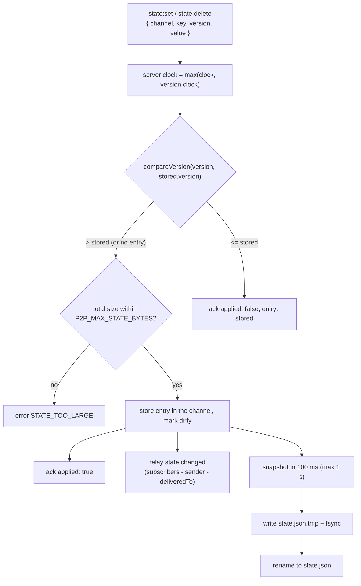

# State Store



`src/server/state-store.ts` on the Server and `src/client/replica.ts` on the Client, both built on `src/protocol/lww.ts`. Frames are in the [Protocol Spec](../1-concepts/protocol-spec.md#53-shared-state).

Every channel has its own entries; one Server clock and one snapshot file serve them all.

---

## 1. Entries and Versions

```typescript
type Version = [clock: number, sessionId: string];

type Entry = {
    value: unknown; // any JSON value; null for tombstones
    deleted: boolean;
    version: Version;
    updatedBy: string; // peerId of the writer (inspector sessions: their peer.id, else "inspect:<sessionId>")
    updatedAt: number; // epoch ms, Server time when accepted (Client time for link-only copies until the Server echo)
};
```

### `compareVersion(a, b)`

1. Greater `clock` wins.
2. Equal clocks: the lexicographically greater `sessionId` wins.
3. Equal versions are the same write: applying it again is a no-op.

### `applyEntry(map, key, entry)`

`map` is one channel's entries. Stores `entry` when `map[key]` is missing or `compareVersion(entry.version, map[key].version) > 0`, and returns whether it did. Every replica (Server store, every Client) uses this one function, whichever transport delivered the entry, so all of them converge on the greatest version of each key.

## 2. Clocks

- The Server keeps one Lamport clock for all channels; a Client keeps one per subscribed channel (a version only ever competes with versions of the same key, so either is enough).
- Receiving any entry or a `subscribe` ack's `clock` raises the local clock to at least that value.
- A local write uses `clock + 1` and stores it as the new clock.
- `sessionId`s are unique, so two writes never share a version.

## 3. Operations

| Operation      | Server behavior                                                                                                                                                                                                    |
| :------------- | :----------------------------------------------------------------------------------------------------------------------------------------------------------------------------------------------------------------- |
| `state:set`    | The sender must be subscribed to `channel` (`NOT_SUBSCRIBED`). `applyEntry` with `{ value, deleted: false }`. On success relay `state:changed`; on a stale version `ack { applied: false, entry }`.                |
| `state:delete` | Same with a tombstone `{ value: null, deleted: true }`. Deleting a missing key still stores a tombstone (it may be racing a set).                                                                                  |
| `state:clear`  | For every live entry of the channel whose version is lower than the frame's version, store a tombstone with the frame's version. Relay one `state:cleared { version, updatedBy }`. `ack { applied: true, count }`. |
| `subscribe`    | The ack sends every entry of the channel, tombstones included.                                                                                                                                                     |

Validation, before any change: `key` is a non-empty string of at most 256 characters; `version[1]` equals the sender's `sessionId`; `version[0]` is a positive safe integer not more than 2^32 above the Server's clock (a buggy or hostile Client cannot jump the clock to `Number.MAX_SAFE_INTEGER`). Violations get `INVALID_ARGUMENT`.

## 4. Size Accounting

- The store tracks the serialized byte size of every entry, of every channel's envelope and of the snapshot envelope, updated incrementally on each change.
- `P2P_MAX_STATE_BYTES` bounds the whole snapshot, all channels together. A write that would bring the total over it is rejected with `STATE_TOO_LARGE` and changes nothing. Deletes and clears always succeed (tombstones are smaller than the values they replace). Creating a channel adds its envelope (about 100 bytes) and fails with `STATE_TOO_LARGE` when that does not fit. Deleting a channel frees all of it.

## 5. Tombstones

Tombstones are kept so that a late, older write (for example one still crossing a link) cannot resurrect a deleted key. At each snapshot the Server purges tombstones whose `updatedAt` is more than 24 hours old. Clients replace a channel's replica with the `subscribe` ack's `state` on every (re)subscribe, which drops purged tombstones too.

## 6. Snapshot Format

`P2P_DATA_DIR/state.json`:

```json
{
    "format": 2,
    "savedAt": 1792000000000,
    "clock": 42,
    "channels": {
        "board:A": {
            "createdAt": 1792000000000,
            "createdBy": "usr_alice",
            "entries": {
                "stroke:1": {
                    "value": { "points": [10, 20, 30, 40], "color": "#0080ff" },
                    "deleted": false,
                    "version": [42, "q0sJ3m9xZ2V4yB7nT1uKpA"],
                    "updatedBy": "usr_alice",
                    "updatedAt": 1792000000000
                }
            }
        }
    }
}
```

- Written as described in [Server › Persistence](../2-server/server.md#4-persistence): debounced 100 ms, at most 1 s, `state.json.tmp` + `fsync` + `rename`.
- A `format: 1` snapshot (protocol version 1, a single shared state) loads as one channel named `default` (`createdBy: ""`) and is written back as format 2 at the next snapshot.
- Any other `format` refuses to load (exit `1`).

## 7. Client Replica

- Each subscribed `Channel` object holds its own replica. `channel.getState()` returns live values only (`{ [key]: value }`, tombstones hidden); `channel.getState(key)` returns one value or `undefined`.
- `setState` / `deleteState` / `clearState` apply locally first (`state:changed` fires with `local: true`), send over links to subscribers, then to the Server. The Promise resolves on `ack`. On `applied: false` the replica applies the returned entry and fires `state:changed` again.
- On reconnect each channel is subscribed again and its replica rebuilt from the ack's `state`; `state:changed` fires for every key whose live value differs from before the disconnect.
- Unsubscribing drops the replica. Writes while disconnected or unsubscribed reject (`DISCONNECTED`, `NOT_SUBSCRIBED`) and change nothing. There is no offline queue.

## 8. Test Contract

`test/state-sync.test.ts`, `test/state-store.test.ts`: per-channel isolation (a write in one channel never reaches another channel's replica); LWW ordering (clock, tie-break, equal versions); convergence of three replicas receiving the same writes in different orders; stale writes acked `applied: false` with the winner; delete vs concurrent set; clear with concurrent newer set; late subscriber receives state after all writers left; restart reloads `state.json` with its channels; format 1 migration to `default`; channel deletion freeing its size; `state.json.tmp` leftover ignored; corrupt `state.json` refuses to start; `STATE_TOO_LARGE`; clock jump rejection; tombstone purge after 24 h (injected clock); debounce coalescing (many writes, one file write).
