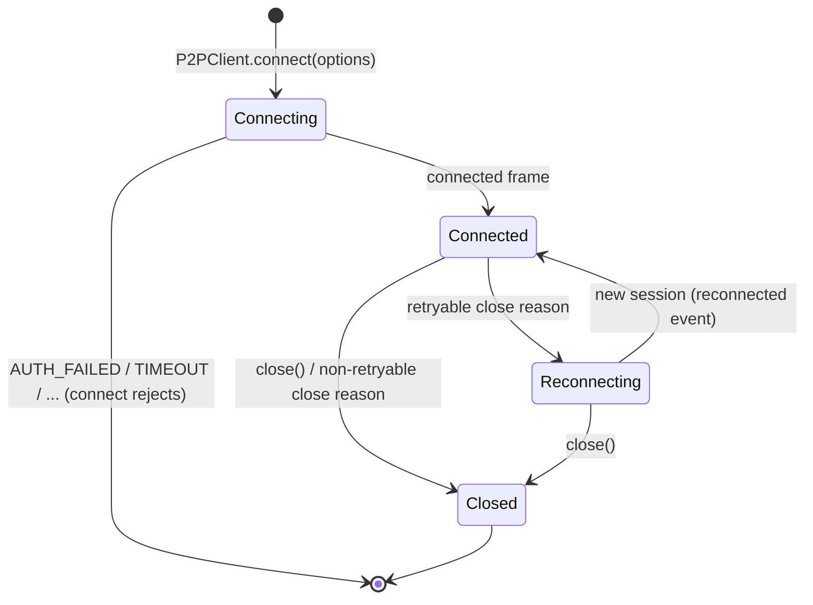

# Client API (`P2PClient`)



`src/client/`, published as the npm package `@fullstacked/p2p` (the client driver only; the Server ships as the `fullstackedorg/p2p` Docker image). The usage guide that ships with the package is the [root README](../../README.md); this page is the normative reference it summarizes. Terms are defined in the [Glossary](../1-concepts/glossary.md).

---

## 1. Connecting

```typescript
import { P2PClient } from "@fullstacked/p2p";

const p2p = await P2PClient.connect({
    host: "127.0.0.1",
    port: 4444,
    user: "rw",
    password: "secret",
    peer: { id: "usr_alice", name: "Alice", meta: { color: "#0080ff" } },
});
```

The same code runs in Node.js, FullStacked apps and the FullStacked CLI: the Client uses `node:net`, which the FullStacked runtime provides. `host` is any host that `node:net` can reach.

### Options

| Option             | Default            | Description                                                                                                                                                                                                                                                                                                                |
| :----------------- | :----------------- | :------------------------------------------------------------------------------------------------------------------------------------------------------------------------------------------------------------------------------------------------------------------------------------------------------------------------- |
| `host`             | _required_         | Server host (anything `node:net` can reach).                                                                                                                                                                                                                                                                               |
| `port`             | `4444`             | Server port.                                                                                                                                                                                                                                                                                                               |
| `user`, `password` | none               | Credentials; they decide the role. Optional against a Server in open mode (everyone is `rw`; `user: "ro"` to try the role that cannot create channels). See [Auth & Roles](../3-subsystems/auth.md).                                                                                                                       |
| `mode`             | `"peer"`           | `"inspect"` for an [inspector session](../3-subsystems/inspection.md#1-inspector-sessions) (any role): never listed in presence; sees presence, subscribes and watches channels to receive their traffic, writes through `query` ([§7](#7-inspection)).                                                                    |
| `peer`             | `{}`               | `{ id?, name?, meta? }`. `id` is the user's identity (typically the authenticated user id) and is shared by all of that user's devices. `meta` is this device's global presence.                                                                                                                                           |
| `deviceId`         | random             | Identifies this Client instance. Generated once per `P2PClient` and kept across its reconnects, so a reconnect replaces the stale session of this device only. Pass a persisted value only if one app instance per device is guaranteed: two live Clients with the same `peer.id` and `deviceId` replace each other.       |
| `deviceLabel`      | detected           | A name for this device that people understand (`"MacBook"`, `"iPhone"`), shown as `PeerInfo.deviceLabel`. Defaults to the detected platform (`"macOS"`, `"iOS"`, `"Android"`, `"Windows"`, `"Linux"`), or `""`.                                                                                                            |
| `beforeConnect`    | _none_             | `async ({ attempt, reason }) => Partial<{ host, port, user, password }>`. Called before the first connection and before every reconnect attempt; the returned fields override the options for that attempt. Use it to refresh credentials or connection details that may have changed (see [§8](#8-connection-lifecycle)). |
| `webrtc`           | auto               | `false` forces socket-only. `{ iceServers }` overrides `connected.iceServers`. Ignored (socket-only) when `RTCPeerConnection` is missing.                                                                                                                                                                                  |
| `reconnect`        | `true`             | `false` disables reconnection, or `{ initialDelayMs: 1000, maxDelayMs: 30000 }` (exponential backoff with full jitter).                                                                                                                                                                                                    |
| `connectTimeoutMs` | `10000`            | TCP connect plus handshake deadline, for the first connect and each reconnect attempt.                                                                                                                                                                                                                                     |
| `timing`           | spec values        | `{ openTimeoutMs: 15000, retryDelayMs: 30000 }`: the link open deadline and retry delay. Shortened by tests only.                                                                                                                                                                                                          |
| `requestTimeoutMs` | `10000`            | Default `request()` timeout.                                                                                                                                                                                                                                                                                               |
| `connect`          | `node:net` connect | `(host, port) => Duplex`. Overrides how the control socket is opened (tests, custom transports). Must yield a byte stream with `write`, `end`, `data`, `close`.                                                                                                                                                            |

`connect()` resolves once `connected` arrives, with the peers and channels already loaded. It rejects with `P2PError` (`AUTH_FAILED`, `SERVER_FULL`, `TIMEOUT`, `DISCONNECTED`) and does not retry the first connection.

### Properties

| Property       | Description                                                            |
| :------------- | :--------------------------------------------------------------------- |
| `sessionId`    | Current session (changes on reconnect).                                |
| `peerId`       | The user's `peerId` (kept across reconnects).                          |
| `deviceId`     | This Client's `deviceId` (kept across reconnects).                     |
| `deviceLabel`  | This Client's `deviceLabel`.                                           |
| `self`         | This session's own `PeerInfo`.                                         |
| `role`         | `"admin"`, `"rw"` or `"ro"`; may change on reconnect (`role:changed`). |
| `capabilities` | `{ webrtc, media }` as sent in `auth`.                                 |
| `connected`    | `true` while the control socket is authenticated.                      |

## 2. Global Presence

A peer is one device of one user. The same `peerId` can appear several times, once per device, and the local user's other devices are listed like anyone else's ([Identity](../1-concepts/architecture.md#2-identity-users-devices-sessions)). Every peer is visible, whatever the channels it or this Client is subscribed to.

```typescript
const peers: PeerInfo[] = p2p.getActivePeers(); // every other peer, one per device
const bobDevices = p2p.getPeers("usr_bob"); // PeerInfo[]: all of Bob's devices
const myOtherDevices = p2p.getPeers(p2p.peerId); // excludes this session
const peer = p2p.getPeer(sessionId); // PeerInfo | undefined
peer.channels; // ["board:A"]: the channels that device is subscribed to
await p2p.updatePresence({ status: "away" }); // this device's global meta
await p2p.updatePresence({ status: null, typing: true }, { merge: true }); // patch: null removes

p2p.on("peer:joined", (peer, { replaces }) => {}); // replaces: previous sessionId of the same device
p2p.on("peer:updated", (peer) => {}); // meta, name or channels changed
p2p.on("peer:left", (peer, reason) => {});
```

- `updatePresence(meta, { name?, merge? })` replaces this session's global `meta` entirely, or patches it with `merge: true` (a key set to `null` is removed); the user's other devices keep their own. Every peer receives it, so keep it small and slow-changing; per-channel information (a viewport, a selection) belongs in [channel presence](#4-channels).
- Key per-device UI (cursors, selections) by `sessionId`, and per-user UI (avatars, "Alice is here") by `peerId`. When `peer:joined` carries `replaces`, move what was keyed by the old `sessionId` to the new one: it is the same device back after a network drop, and its `peer:left` (reason `session_replaced`, `connection_lost` or `heartbeat_timeout`) arrived before, up to 60 s earlier.
- Tell devices of one user apart with `peer.deviceLabel`.

## 3. Direct Messaging

Direct messages and requests reach any peer, whatever its channels.

```typescript
await p2p.send("usr_bob", { type: "chat", text: "Hello!" }); // every device of Bob
await p2p.send({ sessionId: peer.sessionId }, { type: "nudge" }); // one device
await p2p.send(p2p.peerId, { type: "draft-saved" }); // my other devices

const reply = await p2p.request("usr_bob", { type: "ping" }, { timeoutMs: 5000 });

p2p.on("message", async (event) => {
    if (event.reply) await event.reply({ pong: true });
});
```

A target is a `peerId` string, `{ peerId }`, or `{ sessionId }`:

| Method                                  | Target `peerId`                                                                                           | Target `{ sessionId }` |
| :-------------------------------------- | :-------------------------------------------------------------------------------------------------------- | :--------------------- |
| `send(target, data, { ephemeral? })`    | Every device of that user (never this session). Linked devices over links, the rest in one socket frame.  | That device.           |
| `request(target, data, { timeoutMs? })` | **One** device: the most recently connected one. Requests run side effects, so they are never fanned out. | That device.           |

| Method                                  | Resolves when                                                                                                        | Rejects with                                                            |
| :-------------------------------------- | :------------------------------------------------------------------------------------------------------------------- | :---------------------------------------------------------------------- |
| `send(target, data, { ephemeral? })`    | Written to the links and, when some target is not linked, acknowledged by the Server. Ephemeral: as soon as written. | `PEER_NOT_FOUND`, `PAYLOAD_TOO_LARGE`, `DISCONNECTED`                   |
| `request(target, data, { timeoutMs? })` | The target's reply arrives.                                                                                          | `PEER_NOT_FOUND`, `PEER_LEFT`, `TIMEOUT`, `REPLY_ERROR`, `DISCONNECTED` |

To ask every device of a user, call `request` once per `getPeers(peerId)` entry with `{ sessionId }`.

`data` is any JSON value. The `message` event (on `P2PClient` for direct messages, on a `Channel` for its broadcasts):

```typescript
type MessageEvent = {
    from: PeerInfo; // inspector senders: { peerId, sessionId, role, inspector: true, ... }
    data: unknown;
    msgId: string;
    channel?: string; // broadcasts: the channel
    direct: boolean; // send/request: true, broadcast: false
    ephemeral: boolean;
    transport: "webrtc" | "socket";
    reply?: (data: unknown) => Promise<void>; // present for requests only
};
```

- `reply` may be called once; later calls reject with `INVALID_ARGUMENT`. A handler that throws, or calls `event.reply` with an `Error`, sends `reply { error: { message } }` and the requester rejects with `REPLY_ERROR`.
- A request nobody replies to times out on the requester side only.
- Nothing is echoed to the sending session; the sender's other devices receive user-targeted sends (and broadcasts in channels they are subscribed to) like any peer (`from.peerId === p2p.peerId`).

## 4. Channels

A channel scopes the streaming: shared state, broadcasts, channel presence and media reach only its subscribers. Subscribe to what the current screen needs and unsubscribe when it goes away; the channel list and who is subscribed where stay visible without subscribing.

```typescript
// the list screen: no subscription, nothing streamed
const boards = p2p.getChannels(); // ChannelInfo[]: { id, createdAt, createdBy, meta }
const onBoardA = p2p.getSubscribers("board:A"); // PeerInfo[] from global presence
const preview = await p2p.peek("board:A", { keys: ["title", "thumb"] }); // { entries, next?, stats }
p2p.on("channel:created", (info) => {});
p2p.on("channel:updated", ({ channel, by }) => {}); // channel: the new ChannelInfo
p2p.on("channel:deleted", ({ channel, by, sessionId, deviceId }) => {});

await p2p.createChannel("board:B", { meta: { title: "Roadmap" } }); // rw / admin; FORBIDDEN for ro
await p2p.updateChannelMeta("board:B", { title: "Roadmap 2027", color: null }); // rw / admin; a patch
await p2p.deleteChannel("board:B"); // its creator or an admin; subscribers get "closed"

// the board screen
const board = await p2p.subscribe("board:A", { meta: { view: [0, 0, 800, 600] } });
const created = await p2p.subscribe("board:C", { create: { meta: { title: "Ideas" } } }); // create if missing
const next = await p2p.subscribe("board:D", { replace: "board:A" }); // switch in one presence update
p2p.channel("board:D"); // the same Channel object while subscribed
await next.unsubscribe();
```

`subscribe(id, { create?, meta?, replace? })` resolves with a `Channel` once the subscribers and the state are loaded. `create` is `true` or `{ meta }` (the channel's `meta` when it is created). `replace` names a subscribed channel to leave in the same step: its `Channel` closes with `reason: "unsubscribed"`, and other devices see one `peer:updated` instead of a leave followed by a join. It rejects with `INVALID_CHANNEL`, `CHANNEL_NOT_FOUND` (missing, without `create`), `FORBIDDEN` (`create` by `ro`), `CHANNEL_LIMIT`, `NOT_SUBSCRIBED` (`replace` not subscribed), `DISCONNECTED`. Subscribing again to a subscribed channel returns the same object (and replaces its `meta` when given).

| Method                                         | Description                                                                                                                                                                                                |
| :--------------------------------------------- | :--------------------------------------------------------------------------------------------------------------------------------------------------------------------------------------------------------- |
| `getChannels()`                                | Every channel, subscribed or not, with its `meta`.                                                                                                                                                         |
| `getSubscribers(id, { includeSelf? })`         | `PeerInfo[]` of the devices subscribed to a channel, from global presence: no subscription needed. Leaves out this device unless `includeSelf` is `true` (and this device is subscribed).                  |
| `peek(id, { keys?, prefix?, after?, limit? })` | One page of a channel's live entries without subscribing, with the channel's `stats` (`keyCount`, `stateBytes`, `subscriberCount`, `lastWriteAt`, `lastWriteBy`). Does not count toward the channel limit. |
| `createChannel(id, { meta? })`                 | `{ created, channel }`. `rw` / `admin`.                                                                                                                                                                    |
| `updateChannelMeta(id, patch)`                 | Patches the channel's `meta` (a key set to `null` is removed); everyone gets `channel:updated`. `rw` / `admin`. Rejects `INVALID_ARGUMENT` past 4 KiB.                                                     |
| `deleteChannel(id)`                            | Deletes the channel, its state and `meta`. Its creator (any device of that user) or an `admin`; anyone else gets `FORBIDDEN`.                                                                              |

### Who is in which room

Global presence already answers it, without subscribing to anything: `peer.channels` lists the channels each device is in, and `p2p.getSubscribers(id)` filters the peers by channel. `peer:updated` fires whenever a device subscribes, unsubscribes or switches. A room list with live occupancy needs nothing else:

```typescript
const occupancy = (id: string) => p2p.getSubscribers(id, { includeSelf: true }).length;
p2p.on("peer:updated", render);
p2p.on("peer:joined", render);
p2p.on("peer:left", render);
```

### `Channel`

| Member                                         | Description                                                                                                                         |
| :--------------------------------------------- | :---------------------------------------------------------------------------------------------------------------------------------- |
| `id`                                           | The channel id.                                                                                                                     |
| `subscribed`                                   | `true` until `unsubscribe()`, deletion, or a failed resubscribe after a reconnect.                                                  |
| `getSubscribers({ includeSelf? })`             | `Subscriber[]`: `{ peer: PeerInfo, meta }` for every other subscriber, own devices included; this device too with `includeSelf`.    |
| `updatePresence(meta, { merge?, ephemeral? })` | Replaces this session's channel `meta` (or patches it with `merge`), seen by the channel's subscribers only. See below.             |
| `broadcast(data, { ephemeral? })`              | To every other subscriber. Resolves when written to every link and, when some subscriber is not linked, acknowledged by the Server. |
| `getState(key?)`                               | Live values of the channel's shared state (`{ [key]: value }`), or one value.                                                       |
| `setState(key, value)`, `deleteState(key)`     | Writes (see below). Resolve with `{ applied }`.                                                                                     |
| `setStates(entries)`, `deleteStates(keys)`     | Several writes in one frame. Resolve with `{ [key]: { applied } }`.                                                                 |
| `clearState({ prefix? })`                      | Deletes every key, or every key starting with `prefix`. Resolves with `{ applied, count }`.                                         |
| `shareMedia(stream)`, `stopMedia()`            | Shares a `MediaStream` with the channel's media-capable subscribers. See [Media](media.md).                                         |
| `unsubscribe()`                                | Leaves the channel: its replica is dropped and its events stop.                                                                     |

| Event                | Payload                                                | When                                                                                                                  |
| :------------------- | :----------------------------------------------------- | :-------------------------------------------------------------------------------------------------------------------- |
| `subscriber:joined`  | `(Subscriber, { replaces? })`                          | A peer subscribed. `replaces` is the `sessionId` of the same device's previous session when it was in this channel.   |
| `subscriber:updated` | `Subscriber`                                           | A subscriber's channel `meta` changed.                                                                                |
| `subscriber:left`    | `(Subscriber, reason)`                                 | `"unsubscribed"` or the close reason of its session.                                                                  |
| `message`            | `MessageEvent`                                         | A broadcast in this channel.                                                                                          |
| `state:changed`      | `StateChange`                                          | An entry changed (local writes too, with `local: true`).                                                              |
| `state:cleared`      | `{ updatedBy, sessionId, deviceId, prefix?, local }`   | `clearState` by anyone.                                                                                               |
| `media`              | `{ peer, stream, transport }`                          | A subscriber's shared stream is available (again, after a transport switch).                                          |
| `media:ended`        | `{ peer }`                                             | It stopped.                                                                                                           |
| `closed`             | `{ reason: "unsubscribed" \| "channel_deleted", by? }` | The channel ended for this Client: `unsubscribe()`, deleted by `by`, or missing when resubscribing after a reconnect. |

### Channel presence

```typescript
await board.updatePresence({ view: [0, 0, 800, 600], tool: "pen" });
await board.updatePresence({ tool: "eraser" }, { merge: true }); // keeps view
board.updatePresence({ cursor: [x, y] }, { merge: true, ephemeral: true }); // fast path, no ack
board.on("subscriber:updated", ({ peer, meta }) => {}); // meta is always the whole presence
```

- `merge: true` patches: each key replaces that key, `null` removes it, other keys stay. Subscribers receive the whole resulting `meta`.
- `ephemeral: true` resolves at once without an acknowledgement, and the update may be dropped for a subscriber whose connection is congested, like an ephemeral broadcast. The Server still keeps the latest `meta`, so a later subscriber sees it. Send ephemeral updates while something moves (a cursor, a drag) and one regular update when it stops, so every subscriber ends with the final value.

### Shared state

```typescript
const state = board.getState(); // { [key]: value }, live keys only
await board.setState("shape:1", { x: 10, y: 20, color: "#0080ff" });
await board.deleteState("shape:1");
await board.setStates({ "shape:2": { x: 1 }, "shape:3": { x: 2 } }); // one frame
await board.deleteStates(["shape:2", "shape:3"]);
await board.clearState({ prefix: "shape:" });
board.on("state:changed", ({ key, value, deleted, updatedBy, sessionId, deviceId, local }) => {});
```

```typescript
type StateChange = {
    key: string;
    value: unknown; // undefined when deleted
    deleted: boolean;
    updatedBy: string; // the writer's peerId
    sessionId: string; // the writer's session
    deviceId: string; // the writer's device ("" for entries written before protocol 3)
    local: boolean; // this Client's own write
    transport: "webrtc" | "socket" | null; // null for local writes
};
```

- Writes apply locally first and fire `state:changed` with `local: true`; they resolve when the Server acknowledges (accepted in memory, snapshotted within 1 s).
- A write that loses to a concurrent newer one resolves anyway (the operation completed; it simply did not win) and the replica fires `state:changed` with the winning entry. Use `setState(...).then(({ applied }) => ...)` to know.
- `STATE_TOO_LARGE`, `PAYLOAD_TOO_LARGE`, `INVALID_ARGUMENT` (bad key), `NOT_SUBSCRIBED`, `DISCONNECTED` reject without changing the replica.
- `setStates` / `deleteStates` take up to 1 000 keys. The Server applies the batch whole or not at all (a rejection restores every key locally); each key is still resolved by last-write-wins, so some keys of an applied batch may report `applied: false`. Batches go through the Server, never over links.
- `sessionId` and `deviceId` say which device wrote a change, even when every device belongs to the same user.
- To read a channel without subscribing (a preview, a thumbnail), use `p2p.peek`; to write one, [`query`](#7-inspection).

Semantics are defined in [State Store](../3-subsystems/state-store.md).

## 5. Media

```typescript
await board.shareMedia(stream); // MediaStream from getUserMedia / captureStream
await board.stopMedia();
board.on("media", ({ peer, stream, transport }) => {});
board.on("media:ended", ({ peer }) => {});
```

`shareMedia` rejects with `UNSUPPORTED` when `capabilities.media` is `false` (Node.js, FullStacked CLI). One shared stream per channel; calling it again replaces the previous one. See [Media](media.md).

## 6. Transports

```typescript
p2p.getTransport(peer.sessionId); // "webrtc" | "socket", per device
p2p.on("transport:changed", ({ peer, transport }) => {});
```

Links open only between devices that share a channel. See [Transports](transports.md).

## 7. Inspection

```typescript
const schema = await p2p.getSchema(); // any role: peers, channels, counters
const boardA = await p2p.getSchema("board:A"); // one channel: subscribers, keys
const shapes = await p2p.query({ operation: "getState", channel: "board:A", prefix: "shape:" });

// a monitor that sees everything without appearing anywhere
const monitor = await P2PClient.connect({ host, port, user: "ro", password, mode: "inspect" });
monitor.getActivePeers(); // global presence works as for a peer
const board = await monitor.subscribe("board:A"); // a Channel: state, subscribers, events; no writes
const rooms = await monitor.watch("room:"); // every room:* channel, current and future
rooms.on("activity", (a) => console.log(a.channel, a.type)); // subscriber:*, state:*, message
rooms.getSubscribers("room:1"); // Subscriber[] with channel presence
await rooms.close();
```

An inspector's subscriptions and watches are invisible to everyone and do not count toward the channel limit. Its `Channel` objects reject writes, broadcasts and presence updates with `FORBIDDEN`; it writes through `query`. `watch(prefix)` delivers the same events as a subscription for every matching channel, including channels created later, but no state: read it with `peek`. `Activity` is one of:

```typescript
type Activity =
    | { type: "subscriber:joined"; channel: string; subscriber: Subscriber; replaces?: string }
    | { type: "subscriber:updated"; channel: string; subscriber: Subscriber }
    | { type: "subscriber:left"; channel: string; subscriber: Subscriber; reason: string }
    | { type: "state:changed"; channel: string; change: StateChange }
    | { type: "state:cleared"; channel: string; info: StateCleared }
    | { type: "message"; channel: string; event: MessageEvent };
```

`watch` rejects `FORBIDDEN` on a peer session. Watches and subscriptions are renewed after a reconnect.

See [Inspection](../3-subsystems/inspection.md).

## 8. Connection Lifecycle

| Event          | Payload              | When                                                                                                                                                                                                                                                                                |
| :------------- | :------------------- | :---------------------------------------------------------------------------------------------------------------------------------------------------------------------------------------------------------------------------------------------------------------------------------- |
| `disconnected` | `{ reason }`         | The control socket is lost with a retryable reason. Pending acks and requests reject with `DISCONNECTED`; links are closed.                                                                                                                                                         |
| `reconnected`  | `{ sessionId }`      | A new session is established and every channel subscribed again. `peer:joined` / `peer:left` fire for the difference in the peer list, `channel:created` / `channel:deleted` for the channel list, and each `Channel` fires subscriber and `state:changed` events for what changed. |
| `role:changed` | `{ role, previous }` | A reconnect authenticated with a different role (for example `beforeConnect` returned `ro` credentials after write access was withdrawn). Channel creation rules apply from then on.                                                                                                |
| `close`        | `{ reason }`         | Final: `close()` was called, or a non-retryable close reason arrived (`session_replaced`, `auth_failed`, ...). After `session_replaced`, another live Client is using this `peer.id` and `deviceId`.                                                                                |
| `error`        | `P2PError`           | Non-fatal problems with no Promise to reject (a malformed link message, a failed link). Listening is optional.                                                                                                                                                                      |

### Refreshing credentials

Credentials and connection details can change while a Client runs: write access withdrawn, a password rotated, the Server moved. When the connection is cut, the Client sees `connection_lost` and reconnects; `beforeConnect` lets it fetch what is current first:

```typescript
const p2p = await P2PClient.connect({
    host,
    port: 4444,
    user,
    password,
    peer: { id: userId, name },
    beforeConnect: async ({ attempt }) => {
        if (attempt === 0) return {};
        const access = await loadCurrentAccess(); // your own configuration source
        return {
            host: access.host,
            user: access.user,
            password: access.password,
        };
    },
});
p2p.on("role:changed", ({ role }) => setCanCreateBoards(role !== "ro"));
```

An `auth_failed` on a reconnect attempt made with refreshed values is retried (with backoff) while `beforeConnect` is set, since the next call may return valid credentials; without `beforeConnect` it is final.

```typescript
await p2p.close(); // sends bye, closes links and the socket; resolves when the socket is closed
```

## 9. `P2PError`

```typescript
class P2PError extends Error {
    code: ErrorCode; // see the Protocol Spec error table
    reqId?: number;
}
```

Codes are listed in the [Protocol Spec](../1-concepts/protocol-spec.md#31-error-codes).
