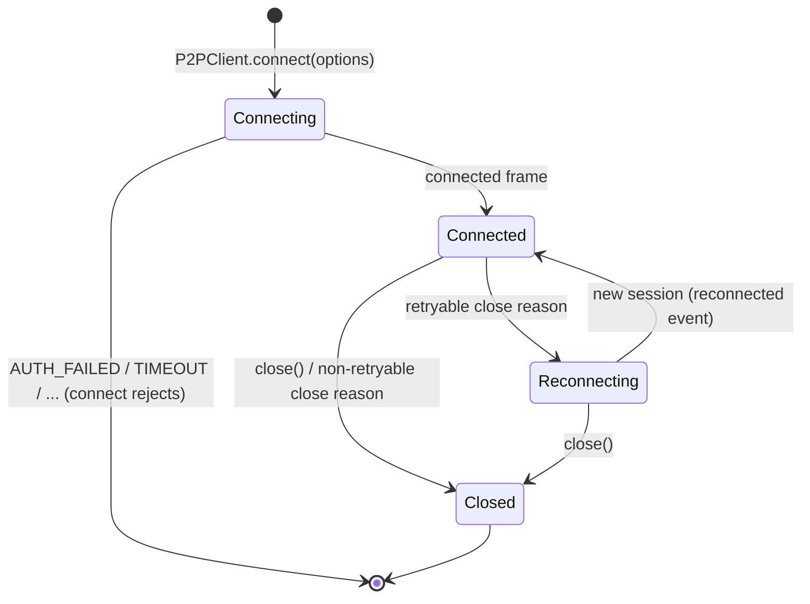

# Client API (`P2PClient`)



`src/client/`, published as the npm package `@fullstacked/p2p` (the client driver only; the Server ships as the `fullstackedorg/p2p` Docker image). The usage guide published with the package is [driver/README.md](../../driver/README.md); this page is the normative reference it summarizes. Terms are defined in the [Glossary](../1-concepts/glossary.md).

---

## 1. Connecting

```typescript
import { P2PClient } from "@fullstacked/p2p";

const p2p = await P2PClient.connect({
    host: "127.0.0.1",
    port: 4444,
    user: "rw",
    password: "secret",
    peer: { id: "usr_alice", name: "Alice", meta: { color: "#0080ff", tool: "brush" } },
});
```

The same code runs in Node.js, FullStacked apps and the FullStacked CLI: the Client uses `node:net`, which the FullStacked runtime provides. `host` is any host that `node:net` can reach.

### Options

| Option             | Default            | Description                                                                                                                                                                                                                                                                                                                |
| :----------------- | :----------------- | :------------------------------------------------------------------------------------------------------------------------------------------------------------------------------------------------------------------------------------------------------------------------------------------------------------------------- |
| `host`             | _required_         | Server host (anything `node:net` can reach).                                                                                                                                                                                                                                                                               |
| `port`             | `4444`             | Server port.                                                                                                                                                                                                                                                                                                               |
| `user`, `password` | none               | Credentials; they decide the role. Optional against a Server in open mode (everyone is `rw`; `user: "ro"` for read-only). See [Auth & Roles](../3-subsystems/auth.md).                                                                                                                                                     |
| `mode`             | `"peer"`           | `"inspect"` for an [inspector session](../3-subsystems/inspection.md#1-inspector-sessions) (any role): invisible, `schema` and `query` only.                                                                                                                                                                               |
| `peer`             | `{}`               | `{ id?, name?, meta? }`. `id` is the user's identity (typically the authenticated user id) and is shared by all of that user's devices. `meta` is this device's presence.                                                                                                                                                  |
| `deviceId`         | random             | Identifies this Client instance. Generated once per `P2PClient` and kept across its reconnects, so a reconnect replaces the stale session of this device only. Pass a persisted value only if one app instance per device is guaranteed: two live Clients with the same `peer.id` and `deviceId` replace each other.       |
| `beforeConnect`    | _none_             | `async ({ attempt, reason }) => Partial<{ host, port, user, password }>`. Called before the first connection and before every reconnect attempt; the returned fields override the options for that attempt. Use it to refresh credentials or connection details that may have changed (see [§8](#8-connection-lifecycle)). |
| `webrtc`           | auto               | `false` forces socket-only. `{ iceServers }` overrides `connected.iceServers`. Ignored (socket-only) when `RTCPeerConnection` is missing.                                                                                                                                                                                  |
| `reconnect`        | `true`             | `false` disables reconnection, or `{ initialDelayMs: 1000, maxDelayMs: 30000 }` (exponential backoff with full jitter).                                                                                                                                                                                                    |
| `connectTimeoutMs` | `10000`            | TCP connect plus handshake deadline, for the first connect and each reconnect attempt.                                                                                                                                                                                                                                     |
| `timing`           | spec values        | `{ openTimeoutMs: 15000, retryDelayMs: 30000 }`: the link open deadline and retry delay. Shortened by tests only.                                                                                                                                                                                                          |
| `requestTimeoutMs` | `10000`            | Default `request()` timeout.                                                                                                                                                                                                                                                                                               |
| `connect`          | `node:net` connect | `(host, port) => Duplex`. Overrides how the control socket is opened (tests, custom transports). Must yield a byte stream with `write`, `end`, `data`, `close`.                                                                                                                                                            |

`connect()` resolves once `connected` arrives, with `peers` and `state` already loaded. It rejects with `P2PError` (`AUTH_FAILED`, `SERVER_FULL`, `TIMEOUT`, `DISCONNECTED`) and does not retry the first connection.

### Properties

| Property       | Description                                                            |
| :------------- | :--------------------------------------------------------------------- |
| `sessionId`    | Current session (changes on reconnect).                                |
| `peerId`       | The user's `peerId` (kept across reconnects).                          |
| `deviceId`     | This Client's `deviceId` (kept across reconnects).                     |
| `self`         | This session's own `PeerInfo`.                                         |
| `role`         | `"admin"`, `"rw"` or `"ro"`; may change on reconnect (`role:changed`). |
| `capabilities` | `{ webrtc, media }` as sent in `auth`.                                 |
| `connected`    | `true` while the control socket is authenticated.                      |

## 2. Presence

A peer is one device of one user. The same `peerId` can appear several times, once per device, and the local user's other devices are listed like anyone else's ([Identity](../1-concepts/architecture.md#2-identity-users-devices-sessions)).

```typescript
const peers: PeerInfo[] = p2p.getActivePeers(); // every other peer, one per device
const bobDevices = p2p.getPeers("usr_bob"); // PeerInfo[]: all of Bob's devices
const myOtherDevices = p2p.getPeers(p2p.peerId); // excludes this session
const peer = p2p.getPeer(sessionId); // PeerInfo | undefined
await p2p.updatePresence({ color: "#10b981", tool: "pen" }); // this device only; READ_ONLY for ro

p2p.on("peer:joined", (peer, { replaces }) => {}); // replaces: previous sessionId of the same device
p2p.on("peer:updated", (peer) => {});
p2p.on("peer:left", (peer, reason) => {});
```

- `updatePresence(meta, { name? })` replaces this session's `meta` entirely; the user's other devices keep their own.
- Key per-device UI (cursors, selections) by `sessionId`, and per-user UI (avatars, "Alice is here") by `peerId`. When `peer:joined` carries `replaces`, move what was keyed by the old `sessionId` to the new one: it is the same device back after a network drop, and its `peer:left` (reason `session_replaced`, `connection_lost` or `heartbeat_timeout`) arrived just before.

## 3. Messaging

```typescript
await p2p.broadcast({ type: "cursor", x: 120, y: 340 }, { ephemeral: true });
await p2p.broadcast({ type: "stroke-end", id: "s1" });

await p2p.send("usr_bob", { type: "chat", text: "Hello!" }); // every device of Bob
await p2p.send({ sessionId: peer.sessionId }, { type: "nudge" }); // one device
await p2p.send(p2p.peerId, { type: "draft-saved" }); // my other devices

const reply = await p2p.request("usr_bob", { type: "ping" }, { timeoutMs: 5000 });

p2p.on("message", async (event) => {
    if (event.reply) await event.reply({ pong: true });
});
```

A target is a `peerId` string, `{ peerId }`, or `{ sessionId }`:

| Method                                  | Target `peerId`                                                                                           | Target `{ sessionId }` |
| :-------------------------------------- | :-------------------------------------------------------------------------------------------------------- | :--------------------- |
| `send(target, data, { ephemeral? })`    | Every device of that user (never this session). Linked devices over links, the rest in one socket frame.  | That device.           |
| `request(target, data, { timeoutMs? })` | **One** device: the most recently connected one. Requests run side effects, so they are never fanned out. | That device.           |

| Method                                  | Resolves when                                                                                                                  | Rejects with                                                                                             |
| :-------------------------------------- | :----------------------------------------------------------------------------------------------------------------------------- | :------------------------------------------------------------------------------------------------------- |
| `broadcast(data, { ephemeral? })`       | Written to every link and, when some peer is not linked, acknowledged by the Server. Ephemeral: as soon as written (no `ack`). | `READ_ONLY`, `PAYLOAD_TOO_LARGE`, `DISCONNECTED`, `TIMEOUT`                                              |
| `send(target, data, { ephemeral? })`    | Written to the links and, when some target is not linked, acknowledged by the Server. Ephemeral: as soon as written.           | `READ_ONLY`, `PEER_NOT_FOUND`, `PAYLOAD_TOO_LARGE`, `DISCONNECTED`                                       |
| `request(target, data, { timeoutMs? })` | The target's reply arrives.                                                                                                    | `READ_ONLY`, `TARGET_READ_ONLY`, `PEER_NOT_FOUND`, `PEER_LEFT`, `TIMEOUT`, `REPLY_ERROR`, `DISCONNECTED` |

To ask every device of a user, call `request` once per `getPeers(peerId)` entry with `{ sessionId }`.

`data` is any JSON value. The `message` event:

```typescript
type MessageEvent = {
    from: PeerInfo; // inspector senders: { peerId, sessionId, role, inspector: true, ... }
    data: unknown;
    msgId: string;
    direct: boolean; // send/request: true, broadcast: false
    ephemeral: boolean;
    transport: "webrtc" | "socket";
    reply?: (data: unknown) => Promise<void>; // present for requests only
};
```

- `reply` may be called once; later calls reject with `INVALID_ARGUMENT`. A handler that throws, or calls `event.reply` with an `Error`, sends `reply { error: { message } }` and the requester rejects with `REPLY_ERROR`.
- A request nobody replies to times out on the requester side only.
- Messages from `ro` peers never arrive (they cannot publish). Nothing is echoed to the sending session; the sender's other devices receive broadcasts and user-targeted sends like any peer (`from.peerId === p2p.peerId`).

## 4. Shared State

```typescript
const state = p2p.getState(); // { [key]: value }, live keys only
const shape = p2p.getState("shape:1");
await p2p.setState("shape:1", { x: 10, y: 20, color: "#0080ff" });
await p2p.deleteState("shape:1");
await p2p.clearState();

p2p.on("state:changed", ({ key, value, deleted, updatedBy, local, transport }) => {});
p2p.on("state:cleared", ({ updatedBy, local }) => {});
```

- Writes apply locally first and fire `state:changed` with `local: true`; they resolve when the Server acknowledges (accepted in memory, snapshotted within 1 s).
- A write that loses to a concurrent newer one resolves anyway (the operation completed; it simply did not win) and the replica fires `state:changed` with the winning entry. Use `setState(...).then(({ applied }) => ...)` to know.
- `READ_ONLY`, `STATE_TOO_LARGE`, `PAYLOAD_TOO_LARGE`, `INVALID_ARGUMENT` (bad key), `DISCONNECTED` reject without changing the replica.

Semantics are defined in [State Store](../3-subsystems/state-store.md).

## 5. Media

```typescript
await p2p.shareMedia(stream); // MediaStream from getUserMedia / captureStream
await p2p.stopMedia();
p2p.on("peer:media", ({ peer, stream, transport }) => {});
p2p.on("peer:media:ended", ({ peer }) => {});
```

`shareMedia` rejects with `UNSUPPORTED` when `capabilities.media` is `false` (Node.js, FullStacked CLI) and `READ_ONLY` for spectators. One shared stream per Client; calling it again replaces the previous one. See [Media](media.md).

## 6. Transports

```typescript
p2p.getTransport(peer.sessionId); // "webrtc" | "socket", per device
p2p.on("transport:changed", ({ peer, transport }) => {});
```

See [Transports](transports.md).

## 7. Inspection

```typescript
const schema = await p2p.getSchema(); // any role
const bob = await p2p.query({ operation: "peers", peerId: "usr_bob" });
const shapes = await p2p.query({ operation: "getState", prefix: "shape:" });

// a tool that inspects without joining the room
const explorer = await P2PClient.connect({ host, port, user: "ro", password, mode: "inspect" });
```

See [Inspection](../3-subsystems/inspection.md).

## 8. Connection Lifecycle

| Event          | Payload              | When                                                                                                                                                                                                 |
| :------------- | :------------------- | :--------------------------------------------------------------------------------------------------------------------------------------------------------------------------------------------------- |
| `disconnected` | `{ reason }`         | The control socket is lost with a retryable reason. Pending acks and requests reject with `DISCONNECTED`; links are closed.                                                                          |
| `reconnected`  | `{ sessionId }`      | A new session is established. `peer:joined` / `peer:left` fire for the difference in the peer list and `state:changed` for every key whose value changed.                                            |
| `role:changed` | `{ role, previous }` | A reconnect authenticated with a different role (for example `beforeConnect` returned `ro` credentials after write access was withdrawn). Spectator rules apply from then on.                        |
| `close`        | `{ reason }`         | Final: `close()` was called, or a non-retryable close reason arrived (`session_replaced`, `auth_failed`, ...). After `session_replaced`, another live Client is using this `peer.id` and `deviceId`. |
| `error`        | `P2PError`           | Non-fatal problems with no Promise to reject (a malformed link message, a failed link). Listening is optional.                                                                                       |

### Refreshing credentials

Credentials and connection details can change while a Client runs: write access withdrawn, a password rotated, the Server moved. When the connection is cut, the Client sees `connection_lost` and reconnects; `beforeConnect` lets it fetch what is current first:

```typescript
const p2p = await P2PClient.connect({
    host,
    port: 4444,
    user,
    password,
    peer: { id: userId, name },
    beforeConnect: async ({ attempt }) => {
        if (attempt === 0) return {};
        const access = await loadCurrentAccess(); // your own configuration source
        return {
            host: access.host,
            user: access.user,
            password: access.password,
        };
    },
});
p2p.on("role:changed", ({ role }) => setReadOnlyUi(role === "ro"));
```

An `auth_failed` on a reconnect attempt made with refreshed values is retried (with backoff) while `beforeConnect` is set, since the next call may return valid credentials; without `beforeConnect` it is final.

```typescript
await p2p.close(); // sends bye, closes links and the socket; resolves when the socket is closed
```

## 9. `P2PError`

```typescript
class P2PError extends Error {
    code: ErrorCode; // see the Protocol Spec error table
    reqId?: number;
}
```

Codes are listed in the [Protocol Spec](../1-concepts/protocol-spec.md#31-error-codes).
