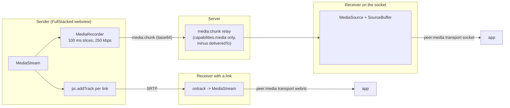

# Media (`shareMedia`)

`src/client/webrtc.ts` (tracks) and `src/client/media-fallback.ts` (recorder and MSE). Requires `capabilities.media`, i.e. a FullStacked webview. Node.js and the FullStacked CLI cannot share or receive media.

---

## 1. Sharing

`p2p.shareMedia(stream)`:

1. Rejects with `UNSUPPORTED` without media capability, `READ_ONLY` for spectators.
2. Adds every track of `stream` to every open link (`pc.addTrack(track, stream)`), renegotiating through `signal` frames. Links opened later get the tracks during their first negotiation.
3. If any visible peer with `capabilities.media` is not linked, starts the recorder (below). The recorder starts and stops as peers join, leave, link and unlink, so it only runs while someone needs it.

`p2p.stopMedia()` removes the tracks from every link, stops the recorder, and sends `media:end`.

## 2. Socket Fallback (MediaRecorder → MSE)

### Sender

- MIME type: `audio/webm;codecs=opus` for audio-only streams, `video/webm;codecs=vp8,opus` with audio and video, `video/webm;codecs=vp8` for video-only. The first type `MediaRecorder.isTypeSupported` accepts is used.
- `audioBitsPerSecond` / `videoBitsPerSecond` sum to 250 kbps; `recorder.start(100)` emits a blob every 100 ms.
- Each blob becomes `media:chunk { streamId, gen, seq, mime, init, data, deliveredTo }`: `streamId` is fixed per `shareMedia` call, `gen` counts recorder (re)starts, `seq` counts chunks within a generation, `init` is `true` for the first chunk of a generation (it holds the WebM header), `data` is base64, and `deliveredTo` lists the linked peers (they have the tracks).
- On `media:resync`, or when a new unlinked media-capable peer appears, the sender restarts the recorder: `gen + 1`, a fresh `init` chunk. Restarts are rate-limited to one per second.

### Server

- Relays `media:chunk` only to members with `capabilities.media`, minus the sender and `deliveredTo`.
- Applies [backpressure](../3-subsystems/room.md#4-backpressure): drops non-`init` chunks above 64 KiB queued, marks the receiver out of sync until the next `init`, and asks the sender for one `media:resync`. Dropping a WebM chunk would corrupt decoding, so the receiver waits for a clean restart instead of decoding garbage.

### Receiver

- On an `init` chunk for a new `(from, streamId)`, creates a `MediaSource` attached to a hidden, muted `<video>` element, adds a `SourceBuffer` for `mime`, and emits `peer:media { peer, stream: video.captureStream(), transport: "socket" }`.
- On an `init` chunk with a new `gen`, resets the `SourceBuffer` (`abort()`, `remove()`) and appends from the new header.
- Appends chunks in `seq` order; a gap in `seq` within a generation drops the rest of that generation until the next `init`.
- Keeps at most 3 seconds buffered behind the playhead and seeks to the live edge when it falls more than 1 second behind (latency stays low after a stall).
- On `media:end` or `peer:left`, ends the `MediaSource` and emits `peer:media:ended`.

## 3. Switching Paths

When a receiver's link opens, the sender adds it to `deliveredTo` (the Server stops relaying chunks to it) and the receiver emits `peer:media` again with the track stream (`transport: "webrtc"`). When the link fails, the reverse happens after the next recorder restart. Applications should simply attach the latest `peer:media` stream for a peer.

## 4. Limitations

- Fallback latency is roughly 300–800 ms (100 ms slices plus buffering), against ~100 ms on links. It is meant to keep media working, not to match WebRTC.
- Base64 adds 33%: one 250 kbps stream costs about 333 kbps per fallback receiver on the Server.
- Fallback media is limited by `P2P_MAX_PAYLOAD_BYTES` per chunk (a 100 ms slice at 250 kbps is about 3 KiB, far below it).

## 5. Test Contract

Integration only (needs a browser engine): `test/integration/media.test.ts` shares a synthetic stream (`<canvas>.captureStream()` plus a Web Audio oscillator) between two FullStacked webview pages; asserts `peer:media` with `transport: "webrtc"` and a live video track; forces one page to `webrtc: false` and asserts `transport: "socket"` with frames advancing (`video.currentTime` grows); asserts a FullStacked CLI peer in the same room never receives `media:chunk` (`schema` counters and its own frame log).
