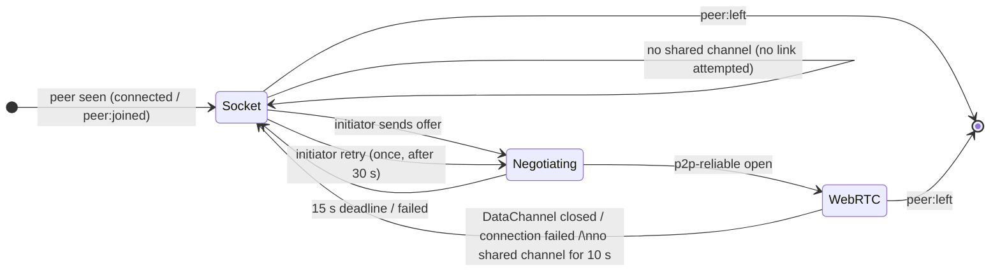

# Transports

`src/client/router.ts` and `src/client/webrtc.ts`. The selection rules are summarized in [Architecture](../1-concepts/architecture.md#4-transport-selection).

---

## 1. The Control Socket (`socket`)

- Opened with `net.connect({ host, port })` from `node:net` and `socket.setNoDelay(true)`. In the FullStacked runtime `node:net` is the runtime's shim.
- It is the first transport and the only one that is always there: from the moment `connect()` resolves, every API works over it, with no waiting for ICE.
- It carries everything the Server must see (handshake, presence, signaling, state writes, inspection) and every frame for peers without an open link.
- Its `close` event is how the Server detects departures; the heartbeat (`ping` / `pong`) covers connections that die silently. See [Protocol Spec › Keep-Alive](../1-concepts/protocol-spec.md#65-keep-alive-and-closing).

### Why TCP is the fallback

When a link cannot be established (roughly 15–20% of pairs on corporate, school and mobile networks) it is almost always because UDP is blocked or both peers are behind symmetric NATs. A TCP connection to the Server works wherever outbound TCP does, so the socket relay keeps every pair connected. To keep latency close to UDP:

- both the Server and the Client disable Nagle's algorithm (`TCP_NODELAY`);
- ephemeral frames are dropped by the Server instead of queued when a recipient falls behind (64 KiB threshold), so a slow receiver gets fresh cursor positions rather than a growing backlog. See [Presence & Channels › Backpressure](../3-subsystems/channels.md#6-backpressure).

The FullStacked runtime's `node:net` shim accepts `setNoDelay` but does nothing with it; latency on that leg depends on the runtime's own transport. The Server always sets `TCP_NODELAY` on its side.

## 2. Links (`webrtc`)

### When a link is attempted

A pair of peers attempts a link when all of these hold:

- both have `capabilities.webrtc` (neither is socket-only);
- they share at least one channel (from global presence: `PeerInfo.channels`);
- neither is an inspector session (inspectors have no links).

Peers that share no channel exchange only direct messages, which the socket relay carries well, so no link is set up for them. When two linked peers stop sharing a channel, the link is kept for 10 seconds (switching boards back and forth reuses it), then closed; both sides report `"socket"`.

### Negotiation

- The initiator is the peer with the greater `sessionId`; it creates the `RTCPeerConnection`, both DataChannels, and the first offer.
- Signaling uses `signal` frames on the control sockets, with trickled ICE candidates.
- Renegotiation (tracks added or removed by `shareMedia`) follows the _perfect negotiation_ pattern: the initiator is impolite, the responder polite, so simultaneous offers resolve without glare.
- ICE servers come from `connected.iceServers` (`P2P_ICE_SERVERS`) unless the `webrtc.iceServers` option overrides them. With none, only host candidates are gathered: links work on a LAN and on loopback (the integration tests), and other pairs stay on the socket relay.

### DataChannels

| Label           | Options                                 | Carries                                                                      |
| :-------------- | :-------------------------------------- | :--------------------------------------------------------------------------- |
| `p2p-reliable`  | `{ ordered: true }`                     | `send`, `broadcast`, `request`, `reply`, `state:*`, `media:announce` frames. |
| `p2p-ephemeral` | `{ ordered: false, maxRetransmits: 0 }` | `send` / `broadcast` frames with `ephemeral: true`.                          |

A link counts as open when `p2p-reliable` is open. If `p2p-ephemeral` is not open yet, ephemeral frames use `p2p-reliable`.

Frames larger than the link's `maxMessageSize` (`pc.sctp.maxMessageSize`, or 65 536 bytes when unavailable) go over the socket instead.

### Receiving on a link

- The sender of a frame on a link is the link's remote `sessionId`; a `from` field inside the message is ignored.
- Channel frames (`broadcast`, `state:*`) carry `channel`; a frame for a channel this Client is not subscribed to is dropped silently (it crossed an unsubscribe).
- Every frame goes through the same deduplication as socket frames (1 024 `msgId`s per sender).

### Failure and retry

- The link must open within 15 seconds of the offer, otherwise the attempt is abandoned.
- `connectionState` `failed`, or `p2p-reliable` closing, returns the pair to the socket; both sides send `link { mode: "socket" }` and emit `transport:changed`.
- The initiator retries once, 30 seconds later, with a fresh `RTCPeerConnection`. Every `signal` carries a negotiation generation (`gen`); the responder replaces its connection when an offer with a newer generation arrives and ignores signals from older ones. After a second failure the pair stays on the socket for the rest of the session.
- Links are closed on `peer:left`, after 10 seconds without a shared channel, on `disconnected`, and on `close()`. After a reconnect, links are negotiated again for the new session as soon as channels are shared again.

## 3. Socket-Only Environments

A Client is socket-only when `RTCPeerConnection` is not a function, or when it was created with `webrtc: false`:

- **Node.js** and the **FullStacked CLI** (`fullstacked -f script.ts`, the `platform/node` binding) have no WebRTC API. Clients there are always socket-only. They are full peers for presence, channels, messaging, requests and state, and lack only media.
- It sends `capabilities: { webrtc: false, media: false }`, so no other peer ever sends it an offer.
- `getTransport()` always returns `"socket"` for it, and its peers report `"socket"` for it.

## 4. Choosing per Frame

| Frame                                          | Linked peer                              | Unlinked peer                                                               |
| :--------------------------------------------- | :--------------------------------------- | :-------------------------------------------------------------------------- |
| `send`, `request`, `reply`                     | link                                     | socket                                                                      |
| `broadcast` (to subscribers)                   | link, listed in `deliveredTo`            | socket (one frame for all unlinked; also sent when the channel is observed) |
| `state:set/delete/clear`                       | link, listed in `deliveredTo`            | socket (always sent, for persistence)                                       |
| `state:batch`                                  | socket (the Server relays it)            | socket                                                                      |
| `state:live`                                   | link (`p2p-ephemeral`), in `deliveredTo` | socket, ephemeral                                                           |
| media                                          | tracks on the link, in `deliveredTo`     | `media:chunk` over the socket                                               |
| presence, subscriptions, signaling, inspection | socket                                   | socket                                                                      |

## 5. Test Contract

- Unit (`test/fallback-transport.test.ts`, with `test/fake-rtc.ts`): initiator choice; no offer to socket-only or inspector peers, nor to peers sharing no channel; link closed after the grace period once no channel is shared; links between two devices of the same `peerId`; frames go over the socket before the link opens and over the link after; `deliveredTo` contents; the socket is skipped entirely when every peer is linked, unless an inspector observes the channel; dedup across a transport switch; oversize frames on the socket; failure deadline and single retry; link frames for an unsubscribed channel dropped.
- Integration: FullStacked CLI peers are socket-only; two FullStacked webview pages open a real link over loopback and stop using the Server for their traffic (checked with `schema` counters). See [Testing](../5-development/testing.md).
