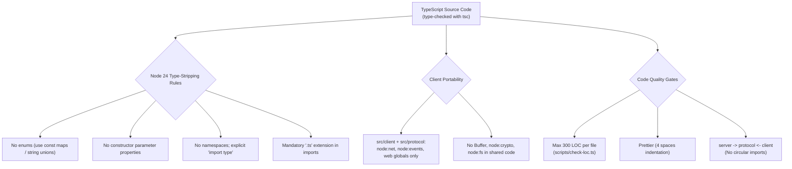

# Code Standards & Syntax Guidelines

## Overview

These rules keep the codebase small, typed and portable. One of them is specific to a client driver: the Client must run unchanged under Node.js, the FullStacked CLI and the FullStacked webview.

---

## 1. Syntax & Formatting Rules

Formatting is enforced across the repository with **Prettier**.

| Property        | Value      | Rationale                                                           |
| :-------------- | :--------- | :------------------------------------------------------------------ |
| `tabWidth`      | `4`        | Clear visual hierarchy across nested callbacks and stream handlers. |
| `useTabs`       | `false`    | Uniform appearance across editors, terminals and git viewers.       |
| `semi`          | `true`     | Explicit semicolons prevent ASI bugs in chained promises.           |
| `singleQuote`   | `false`    | Double quotes, consistent with JSON and protocol frames.            |
| `trailingComma` | `"es5"`    | Cleaner git diffs.                                                  |
| `printWidth`    | `100`      | Readable on split screens.                                          |
| `arrowParens`   | `"always"` | `(arg) => ...` simplifies type annotations.                         |

### Import Conventions

1. **Explicit `node:` protocol** for built-ins: `import net from "node:net";`.
2. **`import type`** for anything used only as a type: `import type { Frame } from "../protocol/types.ts";`.
3. **Explicit `.ts` extensions** on relative imports: `import { encodeFrame } from "../protocol/codec.ts";`.

## 2. Client Portability

`src/protocol/` and `src/client/` are bundled into FullStacked apps and run in three environments. They may import only:

| Allowed                                                                                                    | Forbidden                                                 |
| :--------------------------------------------------------------------------------------------------------- | :-------------------------------------------------------- |
| `node:net`, `node:events`                                                                                  | `node:fs`, `node:crypto`, `node:path`, any other built-in |
| `Uint8Array`, `DataView`, `TextEncoder`, `TextDecoder`, `crypto.getRandomValues`, `queueMicrotask`, timers | `Buffer`, `process` (except behind a `typeof` guard)      |
| `RTCPeerConnection`, `MediaStream`, `MediaRecorder`, `MediaSource`, `document`, behind feature detection   | Unguarded access to browser globals                       |

Feature detection happens once, in `client/client.ts`, and its result travels as `capabilities`. No other module checks globals.

## 3. File Size & LOC Budget

| Metric                         | Upper Limit         | Action on Breach                                                            |
| :----------------------------- | :------------------ | :-------------------------------------------------------------------------- |
| **Max Lines of Code per File** | **300 LOC**         | Decompose the module into focused single-responsibility files.              |
| **Max Function Length**        | **40–50 LOC**       | Extract stages, error handlers or helpers.                                  |
| **Max Cyclomatic Complexity**  | **10 per function** | Replace nested `if/else` ladders with lookup tables (frame type → handler). |

> [!NOTE]
> The 300 LOC limit counts logical lines (ignoring blank lines and full-line comments) in `src/`. It is checked by `npm run check:loc`, part of `npm run check`.

### Module Decomposition

The planned decomposition is in [Internals › Repository Layout](../1-concepts/internals.md#2-repository-layout). The two files most at risk:

- **Client**: `client.ts` (public API and events) delegates to `connection.ts` (socket, acks, heartbeat, reconnect), `router.ts` (transport choice, `deliveredTo`, dedup), `replica.ts` (state), `rpc.ts` (request/reply), `webrtc.ts` (links), `media-fallback.ts` (recorder and MSE).
- **Server**: `session.ts` (per-socket state machine and dispatch table) delegates to `auth.ts`, `room.ts`, `state-store.ts` and `inspect.ts`.

## 4. File & Directory Naming

1. **Directories**: lowercase kebab-case (`docs/3-subsystems/`, `src/server/`).
2. **Source files**: lowercase kebab-case (`state-store.ts`, `media-fallback.ts`).
3. **Well-known exceptions**: `main.ts` (entry point), `index.ts` (package entry per directory).
4. **Types**: `src/protocol/types.ts` for wire types; module-local types next to their module.
5. **Tests**: `<component>.test.ts` in kebab-case. Shared unit helpers in `test/helpers.ts`; integration helpers in `test/integration/helpers/`.

## 5. Node 24+ Native TypeScript Execution Constraints

Node 24 type stripping erases types without generating code, so syntax that produces runtime artifacts is forbidden:

| Forbidden Feature               | Allowed Alternative                                                                         |
| :------------------------------ | :------------------------------------------------------------------------------------------ |
| `enum Foo { ... }`              | `export const CLOSE_REASONS = { clientClose: "client_close" } as const;` plus a union type. |
| `constructor(public x: number)` | Declare the property and assign it in the constructor body.                                 |
| `namespace Foo { ... }`         | ES module exports.                                                                          |
| Ambiguous value/type imports    | `import type { ... }`.                                                                      |
| Unadorned relative imports      | `import { x } from "./x.ts";`.                                                              |

## 6. Architectural Boundaries & Quality Rules

1. **Unidirectional dependencies**: `server` → `protocol` ← `client`. `server` and `client` never import each other.
2. **Deterministic taxonomy**: error codes and close reasons come from the `const` maps in `src/protocol/errors.ts`, which mirror the tables in the [Protocol Spec](../1-concepts/protocol-spec.md). Free-form text goes to logs or `message`, never into `code` or `reason`.
3. **No floating promises**: every Promise is awaited or has a `.catch`.
4. **Never trust the wire**: every field of every received frame is validated before use, on the Server and on links.
5. **No payloads in logs**: log `peerId`s, `deviceId`s, frame types and sizes, never `data`, state values or passwords.
