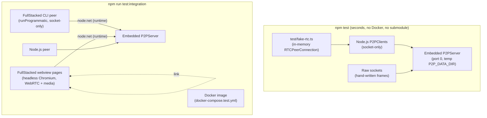

# Testing



Every test maps to a **Test Contract** line in the subsystem documents. The methodology is in [Workflow](workflow.md).

---

## 1. Unit Tests (`test/*.test.ts`)

Run with `npm test` (`TEST=1 node --test test/*.test.ts`). They start an embedded `P2PServer` on port `0` with a temporary `P2P_DATA_DIR` per test file, and connect real `P2PClient`s over loopback TCP. Nothing is mocked except `RTCPeerConnection`, which Node.js does not have.

| File                         | Covers                                                                                                                                                                                                                                                                                                                                                                                                                                                               | Contract                                                                                                                                      |
| :--------------------------- | :------------------------------------------------------------------------------------------------------------------------------------------------------------------------------------------------------------------------------------------------------------------------------------------------------------------------------------------------------------------------------------------------------------------------------------------------------------------- | :-------------------------------------------------------------------------------------------------------------------------------------------- |
| `codec.test.ts`              | Framing, split and coalesced chunks, limits, invalid payloads.                                                                                                                                                                                                                                                                                                                                                                                                       | [Codec](../3-subsystems/codec.md#test-contract)                                                                                               |
| `config.test.ts`             | Defaults, every `P2P_*` variable, validation failures, open mode detection.                                                                                                                                                                                                                                                                                                                                                                                          | [Configuration](../2-server/configuration.md)                                                                                                 |
| `auth.test.ts`               | Constant-time verification, disabled roles, open mode, identical failure closes.                                                                                                                                                                                                                                                                                                                                                                                     | [Auth & Roles](../3-subsystems/auth.md#4-test-contract)                                                                                       |
| `rbac.test.ts`               | Every cell of the permission table, local and Server-side `FORBIDDEN` for channel creation, `meta` changes and deletion; deletion by the creator or an admin only.                                                                                                                                                                                                                                                                                                   | [Auth & Roles](../3-subsystems/auth.md#3-permissions)                                                                                         |
| `presence-messaging.test.ts` | Join/update/leave, `send`, `request`/`reply`, timeouts, `PEER_LEFT`, `REPLY_ERROR`.                                                                                                                                                                                                                                                                                                                                                                                  | [Presence & Channels](../3-subsystems/channels.md#9-test-contract)                                                                            |
| `channels.test.ts`           | Create, subscribe, unsubscribe, delete; `peer:updated` with `channels`; isolation (nothing from unsubscribed channels); channel presence; broadcasts; limits; resubscribe on reconnect; links only between peers sharing a channel.                                                                                                                                                                                                                                  | [Presence & Channels](../3-subsystems/channels.md#9-test-contract), [Client API](../4-client/client-api.md)                                   |
| `channel-features.test.ts`   | Channel `meta` on create, `updateChannelMeta` and restart; `peek` with `keys` / `prefix` / paging and `stats`, outside the channel limit; switching with `replace` (one `peer:updated`); `includeSelf`; merged global and channel presence; ephemeral channel presence without an ack, kept for later subscribers.                                                                                                                                                   | [Client API](../4-client/client-api.md#4-channels), [Protocol Spec](../1-concepts/protocol-spec.md#51-subscribing)                            |
| `multi-device.test.ts`       | One `peerId` on several Clients: coexistence with independent `meta` and links, `peer:joined { replaces }` on a same-device reconnect, replacement never touching other devices, no per-user limit, `send` to a `peerId` / own `peerId` / `{ sessionId }`, `request` to a `peerId` reaching exactly one device (the most recent), state attribution per user, session and device, `replaces` after a drop (in `peer:joined` and `subscriber:joined`), `deviceLabel`. | [Presence & Channels](../3-subsystems/channels.md#9-test-contract), [Client API](../4-client/client-api.md#3-direct-messaging)                |
| `state-sync.test.ts`         | LWW convergence across Clients, stale writes, delete/clear races, late joiners, reconnect diffs, batches (`setStates` / `deleteStates`), prefix clears.                                                                                                                                                                                                                                                                                                              | [State Store](../3-subsystems/state-store.md#8-test-contract)                                                                                 |
| `state-store.test.ts`        | Snapshot format, debounce, atomic write, restart reload, corrupt file, size cap, tombstone purge, clock jump rejection.                                                                                                                                                                                                                                                                                                                                              | [State Store](../3-subsystems/state-store.md#8-test-contract)                                                                                 |
| `fallback-transport.test.ts` | Socket before link, link after, `deliveredTo`, dedup across switches, oversize frames, retry, ephemeral drops, `slow_consumer`, media resync.                                                                                                                                                                                                                                                                                                                        | [Transports](../4-client/transports.md#5-test-contract), [Presence & Channels](../3-subsystems/channels.md#6-backpressure)                    |
| `inspect-query.test.ts`      | Inspector sessions per role, `schema`, every `query` operation per role, paging, counters.                                                                                                                                                                                                                                                                                                                                                                           | [Inspection](../3-subsystems/inspection.md#4-test-contract)                                                                                   |
| `observers.test.ts`          | Inspector sessions seeing presence; invisible exact subscriptions outside the limit, receiving broadcasts (ephemeral too), state and subscriber events; prefix watches following channels created later; one delivery per frame; `FORBIDDEN` for peers watching; renewal after a reconnect.                                                                                                                                                                          | [Inspection](../3-subsystems/inspection.md#1-inspector-sessions), [Protocol Spec](../1-concepts/protocol-spec.md#512-inspector-subscriptions) |
| `lifecycle.test.ts`          | Auth deadline, `server_full`, `payload_too_large`, heartbeat timeout, reconnect with backoff, `bye`, graceful shutdown with final snapshot, health frame and `healthcheck.ts`.                                                                                                                                                                                                                                                                                       | [Protocol Spec](../1-concepts/protocol-spec.md#7-close-reasons), [Server](../2-server/server.md)                                              |
| `utilities.test.ts`          | Logger levels, base64 helpers of the media fallback, device ids, link eligibility, Server errors without a `reqId`.                                                                                                                                                                                                                                                                                                                                                  | [Configuration](../2-server/configuration.md#logging), [Media](../4-client/media.md)                                                          |

### Helpers

- `test/helpers.ts`:
    - `startServer(overrides?)` → `{ server, port, dataDir, close }`: embedded Server with test credentials (`rw`/`ro`/`admin` passwords set), short heartbeat values, port `0`, `mkdtemp` data dir removed on `close`.
    - `connectClient(port, options?)`: `P2PClient.connect` with test defaults and automatic `close()` in `after`.
    - `rawSocket(port)`: a framed socket for protocol-level tests (`send(frame)`, `next(type?)`, `closed`), used to send malformed or forbidden frames a real Client would never send.
    - `waitForEvent(emitter, event, predicate?, timeoutMs = 2000)`.
- `test/fake-rtc.ts`: `installFakeRTC()` defines `RTCPeerConnection` on `globalThis` for the duration of a test. Fake connections pair through the SDP they exchange over real `signal` frames, so signaling goes through the real Server; DataChannels deliver in-memory. Knobs: `openDelayMs`, `block` (connections never open, so link deadlines fire), `maxMessageSize`; `liveConnections()` and `pc.breakLink()` simulate a link dropping. Restored in `after`.

Time-dependent rules (24 h tombstone purge, 30 s link retry) take an injectable clock (`now()`) and timer functions; the tests do not wait in real time.

## 2. Integration Tests (`test/integration/*.test.ts`)

Run with `npm run test:integration`. They exercise the Client in the real runtimes it targets and the shipped Docker image. Zero mocks.

### 2.1 Submodule: the FullStacked Runtime

The repository includes [`fullstackedorg/fullstacked`](https://github.com/fullstackedorg/fullstacked) (branch `v1`) as a submodule at `integration/fullstacked`. It provides the FullStacked CLI (`platform/node`), the webview used by the browser tests, and the runtime's `node:net`, through which CLI scripts and webview pages connect to the P2P Server directly.

```bash
# every fresh clone
git submodule update --init --recursive
npm ci
npm ci --prefix integration/fullstacked
```

Bump the runtime with `git -C integration/fullstacked pull`, then commit the new pointer and run `git submodule update --init --recursive`.

The submodule is not a runtime dependency: `src/` never imports it, and the Docker image does not contain it (`.dockerignore` excludes `integration`).

### 2.2 Runtime Build

Before the first runtime test, `test/integration/helpers/runtime.ts` compares the submodule commit plus its uncommitted changes with a build stamp (`core/bin/.integration-build`) and, when they differ, runs `npm run build && npm run build -w platform/node` in `integration/fullstacked` once, under a lock shared by concurrent test files. The build needs Go.

### 2.3 Helpers

| Helper                | Provides                                                                                                                                                                                                                                                                                                                                                                                                                                                                                  |
| :-------------------- | :---------------------------------------------------------------------------------------------------------------------------------------------------------------------------------------------------------------------------------------------------------------------------------------------------------------------------------------------------------------------------------------------------------------------------------------------------------------------------------------- |
| `helpers/runtime.ts`  | `runProgrammatic(script)`: runs a script in the **FullStacked CLI** (`fullstacked -f`) and rejects on a non-zero exit. `openPages(app, count)`: bundles one app and opens it in `count` pages of one headless Chromium, each with its own runtime context and webview (like one app per device), each told its index through `?i=`. Returns `results()` (every page's final body text) and `end()`. `clientImport()`: the relative import of `src/client/index.ts` for generated scripts. |
| `helpers/page-app.ts` | `pageApp({ port, body, webrtc?, role?, peerId? })`: the app every page runs. It connects `P2PClient` to `127.0.0.1:port`, runs `body` with `p2p`, `i`, `check`, `until` and `waitFor` in scope, and reports the returned JSON (`done`) or the error (`error`) in the page body.                                                                                                                                                                                                           |
| `helpers/p2p.ts`      | `startP2P()`: the embedded Server with the spec's real heartbeat (10 s / 30 s). The runtime runs in the test process and can stall its event loop longer than the unit tests' 1 s timeout.                                                                                                                                                                                                                                                                                                |
| `helpers/env.ts`      | `PORTS.p2p` (`TEST_P2P_PORT`, default `4444`) and `CREDENTIALS` for the Docker image.                                                                                                                                                                                                                                                                                                                                                                                                     |

Scripts and pages run apart from the test's own Node.js peers, so tests coordinate through the Server itself: participants subscribe to a `test` channel and announce readiness with `setState("ready:<label>", true)` in it, the Node test process drives the scenario (requests, broadcasts, a `finish` key), and a CLI script exits when it receives a `{ type: "done" }` message. `runProgrammatic` is started without `await`, the scenario runs, then the test awaits it to collect the script's own checks.

### 2.4 Suites

| File                       | Runtimes                                          | Asserts                                                                                                                                                                                                                                                                                                                                                                                                                                                                                                                           |
| :------------------------- | :------------------------------------------------ | :-------------------------------------------------------------------------------------------------------------------------------------------------------------------------------------------------------------------------------------------------------------------------------------------------------------------------------------------------------------------------------------------------------------------------------------------------------------------------------------------------------------------------------- |
| `fullstacked-node.test.ts` | FullStacked CLI + Node.js                         | The CLI peer sends `capabilities.webrtc: false` and every transport reports `"socket"`. Presence both ways, `request`/`reply` both ways, state written by the CLI peer seen by Node and by a late subscriber after the CLI peer exits, an `ro` CLI peer getting `FORBIDDEN` when it creates a channel but writing inside an existing one, reconnect after the Server restarts, with the channel subscribed again and its state kept.                                                                                              |
| `browser.test.ts`          | 2 FullStacked webview pages                       | the runtime's `node:net` works in the webview; a link opens (`transport:changed` → `"webrtc"`); reliable and ephemeral broadcasts and a `request` cross it; `schema.stats.skippedByDeliveredTo` grows while `relayedFrames` stays flat for that traffic; a page with `webrtc: false` stays on `"socket"`; two pages subscribed to different channels release their link and receive nothing from each other.                                                                                                                      |
| `mixed.test.ts`            | 2 webview pages + FullStacked CLI + Node.js       | All four subscribed to one channel. Webview ↔ webview on links, every other pair on the socket; one broadcast from a page reaches each of the 3 others exactly once; concurrent `setState` on one key from all 4 converges to the same winner everywhere; a page closing mid-scenario yields one `peer:left` per peer. Two of the four Clients share one `peerId` (one user on a webview page and in the CLI): both are listed, each gets the other's broadcasts, and a `send` to that `peerId` from a third Client reaches both. |
| `media.test.ts`            | 2 webview pages + Node.js                         | See [Media › Test Contract](../4-client/media.md#5-test-contract).                                                                                                                                                                                                                                                                                                                                                                                                                                                                |
| `package.test.ts`          | npm tarball + Node.js + FullStacked CLI + webview | `npm pack` at the root holds the driver, its esbuild output (`dist/index.js`) and the driver README only (no server, docs, tests or scripts); the tarball installed under the test app imports as `@fullstacked/p2p` in plain Node.js (the `node` condition, `dist/`), a FullStacked CLI script and a webview page (the TypeScript sources).                                                                                                                                                                                      |
| `docker.test.ts`           | Docker image + Node.js                            | Container becomes `healthy`; env credentials apply; state survives `docker compose restart p2p`; `docker compose stop` sends `server_shutdown` and the Client reconnects when the container starts again.                                                                                                                                                                                                                                                                                                                         |

### 2.5 Docker Compose

`docker-compose.test.yml` runs the image under test, built from the repository's `Dockerfile`:

```yaml
services:
    p2p:
        build:
            context: .
            dockerfile: Dockerfile
        restart: unless-stopped
        environment:
            P2P_RW_PASSWORD: secret
            P2P_RO_PASSWORD: spectate
            P2P_ADMIN_PASSWORD: admin
        ports:
            - "${TEST_P2P_PORT:-4444}:4444"
```

`scripts/test-integration.ts` runs `docker compose up -d --build` (the image is always rebuilt from the checkout), `node --test` over `test/integration/*.test.ts` (or the files given as arguments), then always `docker compose down --volumes --remove-orphans`, also on failure or Ctrl-C. Files run one at a time (`--test-concurrency=1`) because each drives the FullStacked runtime, whose webviews share ports. `KEEP_SERVICES=1` leaves the container up between runs. Only `docker.test.ts` uses the container; the other suites use an embedded Server so they can inspect it.

### 2.6 Browser Notes

- Two pages of one headless Chromium connect over loopback with host candidates, so no STUN server is needed. Chromium hides host IPs behind mDNS names by default, so `openPages` launches Chromium with `--disable-features=WebRtcHideLocalIpsWithMdns`. The FullStacked `createBrowser` helper takes no launch flags, so `openPages` composes the same pieces itself: `run` (core `run` lib), `createWebView` (`platform/node`) and `launchBrowser({ args })` (`test/browser.ts`).
- Media tests use synthetic sources (`canvas.captureStream()` and a Web Audio oscillator), so no camera, microphone or permission prompt is involved.
- `SHOW_BROWSER=1` (honored by the FullStacked harness) opens a visible browser with devtools to watch the pages.
- `DEBUG_PAGES=1` prints every page's console output.
- One runtime context streams socket data to a single page, so each page gets its own context and webview; pages in one context would stall each other's control sockets.
- Puppeteer's default `waitForFunction` polling uses `requestAnimationFrame`, which never fires in background tabs; `results()` polls every 100 ms instead.

## 3. Running

```bash
npm test                                   # unit
npm run test:coverage                      # unit with coverage (target >= 95%)
npm run test:integration                   # everything under test/integration
npm run test:integration -- test/integration/browser.test.ts   # one suite
KEEP_SERVICES=1 npm run test:integration   # keep the container between runs
```
