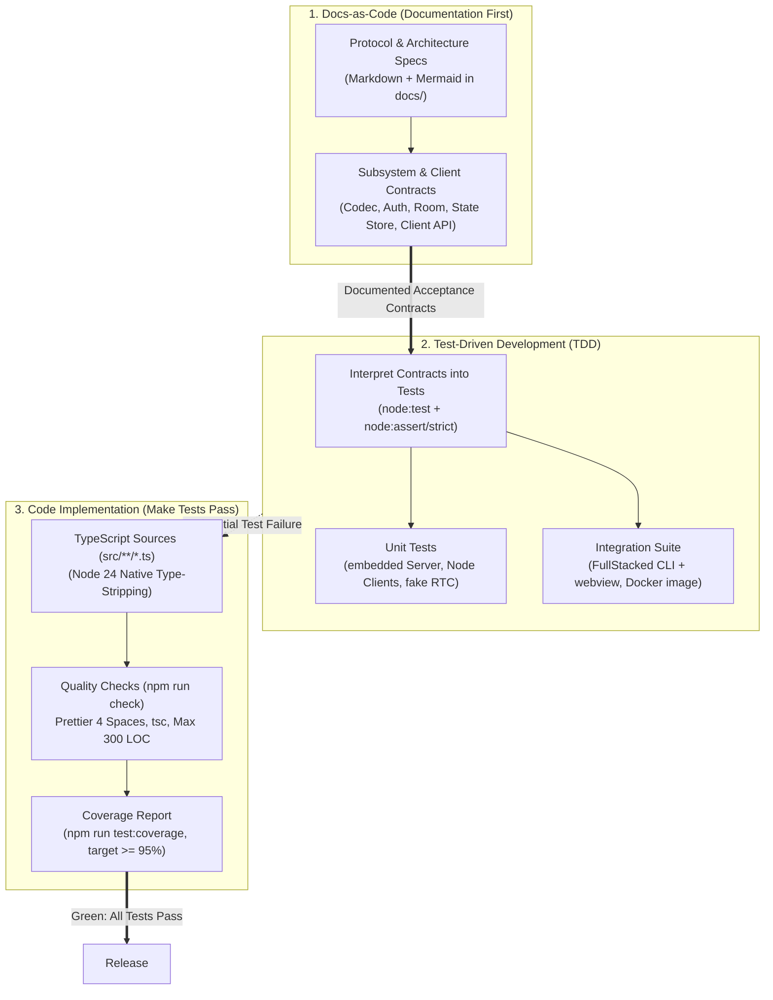
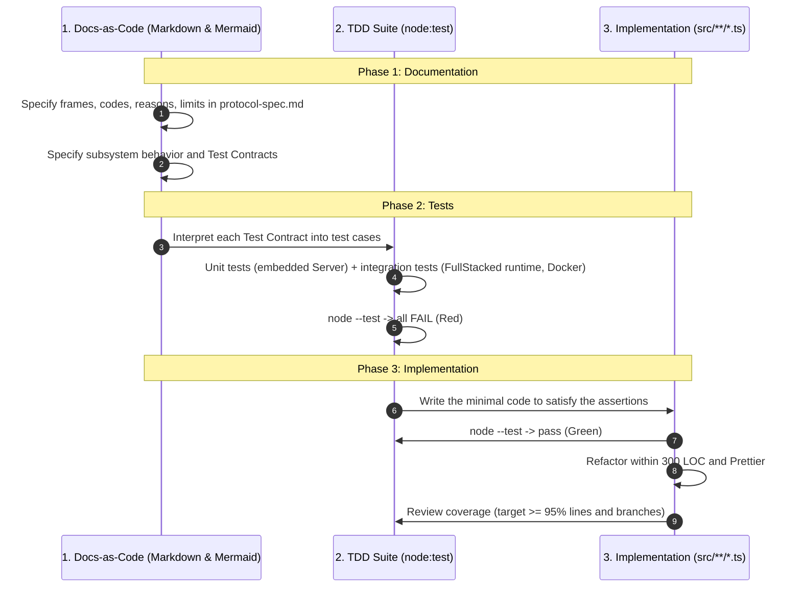

# Workflow & Tooling



## Overview

This repository follows a specification-first methodology: **Docs-as-Code → Test-Driven Development → Code Implementation**.

Every frame, error code, close reason, limit and API is specified in `docs/` first. Each subsystem document ends with a **Test Contract** section listing what its tests must prove. Those contracts become `node:test` suites that fail first (red), then the TypeScript sources are written until they pass (green), within the 300 LOC budget and Prettier formatting.

---

## 1. The Core Development Lifecycle



### Phase 1: Documentation

1. **Single source of truth.** Wire-level changes start in the [Protocol Spec](../1-concepts/protocol-spec.md); behavior changes in the matching subsystem or client document; settings in [Configuration](../2-server/configuration.md).
2. **Closed taxonomies.** New failure modes get an error code or close reason in the Protocol Spec tables before any code uses them.
3. **Test Contracts.** Every subsystem document lists the cases its tests must cover. A behavior without a contract line is not specified.

### Phase 2: Tests

1. **Contracts become tests.** Each Test Contract line maps to at least one test in `test/*.test.ts` or `test/integration/*.test.ts`.
2. **Two tiers.** Unit tests run in-process in seconds; integration tests exercise the real runtimes and the Docker image. See [Testing](testing.md).
3. **Red first.** Tests are run before the implementation exists, proving they test the contract.

### Phase 3: Implementation

1. **Green.** Write `src/**/*.ts` until the suite passes.
2. **Compliance.** Node 24 type-stripping rules, client portability rules, 300 LOC, Prettier (see [Standards](standards.md)).
3. **Coverage.** `npm run test:coverage` targets 95% line and branch coverage. It is a review target, not an automated gate.

---

## 2. Direct Node Execution

Node.js 24 strips types from `.ts` files on the fly. No build step:

```bash
# Server in development: no configuration (port 4444, ./data, open mode)
node src/server/main.ts

# Server with credentials
P2P_RW_PASSWORD=secret P2P_ADMIN_PASSWORD=admin node src/server/main.ts
```

`TEST=1` is set by the test scripts for the FullStacked submodule (it disables its native webview); the Server never reads it.

---

## 3. Automation Scripts (`package.json`)

```json
{
    "name": "fullstacked-p2p",
    "version": "0.1.0",
    "private": true,
    "type": "module",
    "scripts": {
        "start": "node src/server/main.ts",
        "fmt": "prettier --write .",
        "fmt:check": "prettier --check .",
        "typecheck": "tsc --noEmit",
        "check:loc": "node scripts/check-loc.ts --max 300",
        "check": "npm run fmt:check && npm run typecheck && npm run check:loc",
        "test": "TEST=1 node --test test/*.test.ts",
        "test:coverage": "TEST=1 node --test --experimental-test-coverage test/*.test.ts",
        "test:integration": "node scripts/test-integration.ts"
    },
    "prettier": {
        "tabWidth": 4,
        "useTabs": false,
        "semi": true,
        "singleQuote": false,
        "trailingComma": "es5",
        "printWidth": 100,
        "arrowParens": "always"
    },
    "devDependencies": {
        "@types/node": "^26.6.5",
        "prettier": "^3.9.10",
        "puppeteer": "^25.16.0",
        "typescript": "^7.0.2"
    }
}
```

- The root package is private: it holds the scripts and dev tools. The npm package `@fullstacked/p2p` is published from `driver/` (see below).
- No `dependencies`: the Server and Client use Node.js built-ins and web globals only.
- `puppeteer` drives the FullStacked webview in the integration tests (the FullStacked `test/browser.ts` harness imports it from the consumer's `node_modules`).
- `.prettierignore` excludes `node_modules`, `integration/`, `data`, `test/integration/tmp` and `*.ts.js` (FullStacked bundle outputs).

### Publishing the driver

```bash
cd driver
npm publish --access public   # prepack copies src/client and src/protocol into driver/src
```

`driver/package.json` names the package `@fullstacked/p2p`, exports `./src/client/index.ts` and ships `src` plus `driver/README.md`, the usage guide. Bump its `version` independently of the Server image. `test/integration/package.test.ts` packs it, installs the tarball and imports it from the FullStacked CLI and webview.

`scripts/check-loc.ts` counts logical lines of every `.ts` file under `src/` and fails above the limit.

---

## 4. Quality Practices

### A. Pre-Commit Quality Gate

No hook or CI workflow ships with the repository. Enable one locally:

```bash
#!/bin/sh
npm run check
```

### B. Native Test Runner

```typescript
import test from "node:test";
import assert from "node:assert/strict";

test("a spectator's broadcast is rejected with READ_ONLY", async () => {
    // ...
});
```

No Jest, no Mocha; native coverage with `--experimental-test-coverage`.

### C. Architectural Boundary Checks

- `src/server/**` never imports `src/client/**`, and the reverse.
- `src/protocol/**` imports nothing outside `src/protocol/`.
- `src/client/**` and `src/protocol/**` import only `node:net` and `node:events` among built-ins (see [Standards › Client Portability](standards.md#2-client-portability)).
